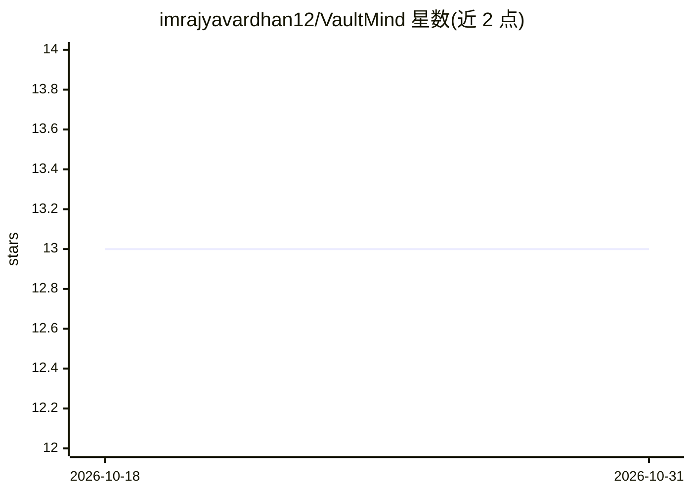

# imrajyavardhan12/VaultMind

⭐ 13 · Python · MIT · 推送 2026-10-25 · [GitHub](https://github.com/imrajyavardhan12/VaultMind) · 个人维护

**本地优先 CLI：用 LLM 将 Obsidian 剪藏资料编译成可问答的 wiki**

面向个人知识管理的命令行工具：读取 Obsidian vault 中由 Web Clipper 保存的原始 Markdown 资料（📥 Raw/，只读不改），由 LLM 生成并持续维护概念页、索引与日志（🗺️ Wiki/），配合 VAULTMIND.md schema 约束页面格式与引用规则。主循环为 vm compile（增量编译概念页并同步引用）、vm ask（优先检索已编译 wiki，回退 Raw，答案归档可复用）、vm lint（确定性健康检查）。支持 Anthropic/OpenAI/OpenRouter/Ollama 的运行时回退链，各命令提供 no-write 预览模式；明确不引入向量数据库、LangChain 等组件。经 PyPI 发布，推荐用 uv/pipx 隔离安装。

## 筛选速览

| 维度 | 判定 | 备注 |
|---|---|---|
| AI 角色 | `ai-native` | 本体是模型或模型工具 |
| 许可风险 | `permissive` | MIT |
| 部署形态 | `library` | 以包/库形式分发 |
| 模型依赖 | local-ok | 支持本地模型 |
| 硬件要求 | — | 无带数字的原话,不猜 |
| 安装摩擦 | `low` | 无编译、无系统依赖或容器化 |
| 成熟度 | — | 结构信号不足 |

## 能力要点

- vm compile 增量编译 Raw 源为概念页，确定性强制标题规范并同步来源引用
- vm ask 优先检索已编译 wiki 与历史答案，deep 模式最多三轮有据综合
- Anthropic/OpenAI/OpenRouter/Ollama 运行时回退链，瞬时错误有界重试
- 全部命令支持 no-write 预览模式，变更可用 git diff 审查

## 适用场景

- 把剪藏的文章、论文、笔记整理成可复用的个人 wiki
- 对已编译知识库提问并沉淀可检索的答案
- 定期用 lint 报告检查孤儿源、重复概念与失效链接

## 场景标签

`知识库管理` `文档问答` · 领域:知识与检索

## 证据(README 行号)

> L5: VaultMind is a local-first CLI for building a personal LLM-maintained wiki inside an Obsidian vault.
> L46: You save original source documents into Obsidian. VaultMind reads those sources, identifies concepts, creates and u
> L132: 4. Ask the LLM which concepts should be created or updated.

## 星数曲线

2026-10-18 13 → 2026-10-31 13（+0）

---
*卡片 v1 · prompt 1.4 · 生成 2026-10-31 · 置信度 high · 依据 README sha `b8430fbc45e4` · [字段定义](../../DATASET.md)*
