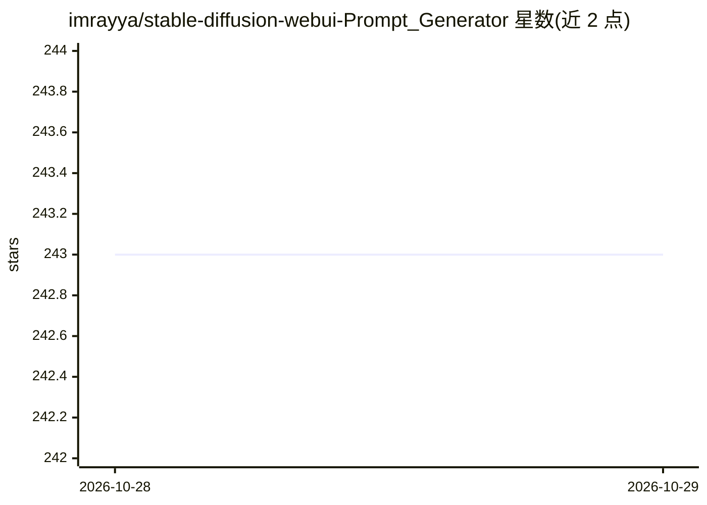

# imrayya/stable-diffusion-webui-Prompt_Generator

⭐ 243 · Python · MIT · 推送 2026-10-27 · [GitHub](https://github.com/imrayya/stable-diffusion-webui-Prompt_Generator) · 个人维护

**给 Stable Diffusion WebUI 用户的提示词生成扩展**

AUTOMATIC1111 Stable Diffusion WebUI 的扩展，安装后在 WebUI 中增加一个标签页：用户输入基础提示词开头，选择模型后生成扩展的完整提示词。基于 FredZhang7/distilgpt2-stable-diffusion-v2 与 Gustavosta/MagicPrompt-Stable-Diffusion 两个模型，首次使用时模型下载到本地缓存后离线运行。支持温度、Top K、最大长度、重复惩罚、黑名单过滤等参数，可通过编辑 models.json 添加 Hugging Face 上的其他模型。作者声明仅为移植工作。

## 筛选速览

| 维度 | 判定 | 备注 |
|---|---|---|
| AI 角色 | `ai-native` | 本体是模型或模型工具 |
| 许可风险 | `permissive` | MIT |
| 部署形态 | `None` |  |
| 模型依赖 | — | README 未给出锁定关系 |
| 硬件要求 | — | 无带数字的原话,不猜 |
| 安装摩擦 | `low` | 无编译、无系统依赖或容器化 |
| 成熟度 | — | 结构信号不足 |

## 能力要点

- 从短基础提示词生成完整 Stable Diffusion 提示词
- 内置两个默认模型，下载后本地离线运行
- 支持温度/Top K/重复惩罚/黑名单过滤等参数
- 可通过 models.json 接入 Hugging Face 上的更多模型

## 适用场景

- 写图时从简短想法扩展成详细提示词
- 离线批量生成多个提示词候选供挑选
- 为不同风格需求切换或添加提示词生成模型

## 场景标签

`提示工程` · 领域:Agent 开发

## 证据(README 行号)

> L3: Adds a tab to the webui that allows the user to generate a prompt from a small base prompt. Based on FredZhang7/dist
> L14: 1. Write in the prompt in the *Start of the prompt* text box
> L16: 3. Click Generate and wait

## 星数曲线

2026-10-28 243 → 2026-10-29 243（+0）

---
*卡片 v1 · prompt 1.4 · 生成 2026-10-28 · 置信度 high · 依据 README sha `6bad8f7487a3` · [字段定义](../../DATASET.md)*
