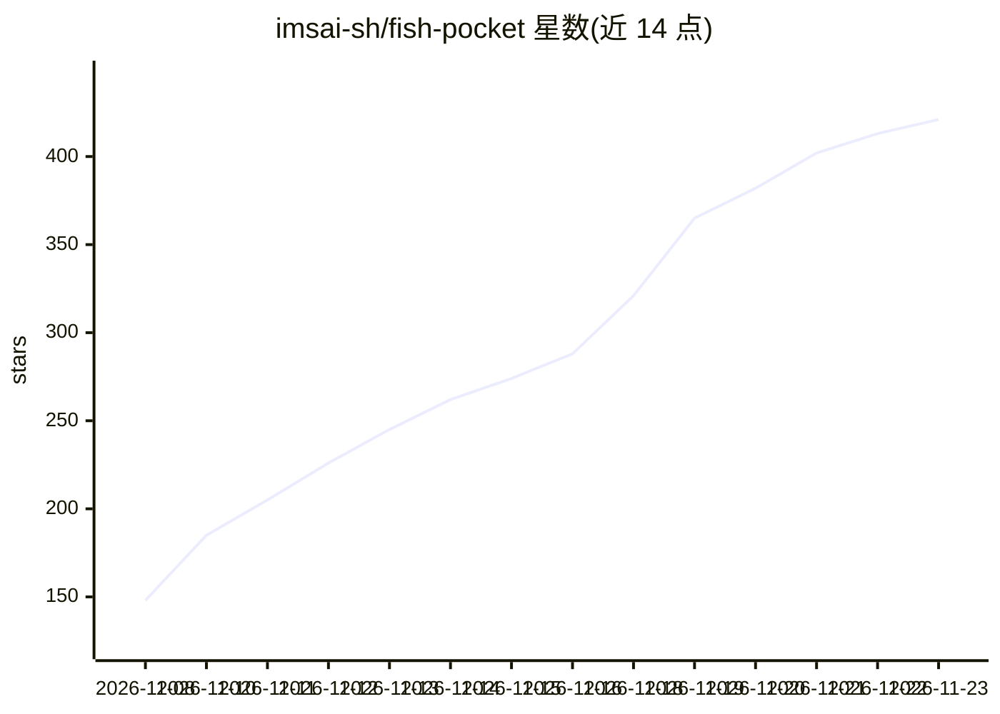

# imsai-sh/fish-pocket

⭐ 421 · Swift · NOASSERTION · 推送 2026-11-22 · [GitHub](https://github.com/imsai-sh/fish-pocket) · [官网](https://apps.apple.com/cn/app/fish-pocket/id6830703602) · 个人维护 · 中文 README

**在 iPhone/iPad 上本机运行 DSH 智能体引擎的原生 App**

开源 iOS 应用，将 DeepSeek Harness（DSH）的 Agent 引擎完整嵌入 App 本机运行，不依赖电脑或服务器；界面用 SwiftUI 原生重写，功能对齐 DSH 官方 Web UI。引擎之下原生嵌入 Node 24、Python 3.15、libgit2 与 FFmpeg（均为 App 内线程，非子进程），智能体可直接使用 iPhone 日历、提醒、健康、照片等本机能力。模型调用仍需联网，默认 DeepSeek，也可配置其他服务商。另含 Bot 模式、远程控制电脑上的 Codex/Claude Code 会话、iCTRL 操控手机等可选功能。通过 TestFlight 或 App Store（非中国大陆）安装，也可自行编译。

## 筛选速览

| 维度 | 判定 | 备注 |
|---|---|---|
| AI 角色 | `ai-native` | 本体是模型或模型工具 |
| 许可风险 | `none` | NOASSERTION |
| 部署形态 | `library` | 以包/库形式分发 |
| 模型依赖 | locked-api |  |
| 硬件要求 | — | 无带数字的原话,不猜 |
| 安装摩擦 | `medium` | 含编译或系统依赖之一 |
| 成熟度 | — | 结构信号不足 |

## 能力要点

- DSH Agent 引擎以原生代码嵌入 App 本机运行，不连电脑和服务器
- 原生嵌入 Node 24、Python 3.15、libgit2、FFmpeg，绕过 iOS 子进程限制
- 智能体直接使用 iPhone 本机能力（日历、提醒、健康、照片、地图等），逐项手动开启
- 支持 Bot 模式、远程控制电脑端 Codex/Claude Code/DSH 会话、插件市场（抽样 50 个中 42 个直接可用）

## 适用场景

- 在 iPhone/iPad 上离线于本机跑 DSH 智能体做编码和自动化任务
- 让智能体读写系统日历、提醒、健康数据并操作其他 App
- 在手机上统一管理电脑和服务器里的 Codex、Claude Code 会话

## 场景标签

`编码 Agent` `AI 助手` · 领域:编码与开发

## 证据(README 行号)

> L5:  在 iPhone 和 iPad 上本机运行 DSH（DeepSeek Harness），界面完全原生
> L7:  本机运行不靠电脑，不靠服务器，不是网页套壳。引擎就跑在 App 里，每个页面都用 SwiftUI 重写，iPhone 和 iPad 都是原生体验。
> L165: Fish Pocket 是一款开源的 iOS App，把 DeepSeek Harness（简称 DSH）的整个 Agent 引擎装进 iPhone 和 iPad，在本机运行。不用连电脑，也不用连服务器，界面用 SwiftUI 

## 星数曲线

2026-11-08 148 → 2026-11-23 421（+273）

---
*卡片 v1 · prompt 1.4 · 生成 2026-11-17 · 置信度 mid · 依据 README sha `c331866ebf76` · [字段定义](../../DATASET.md)*
