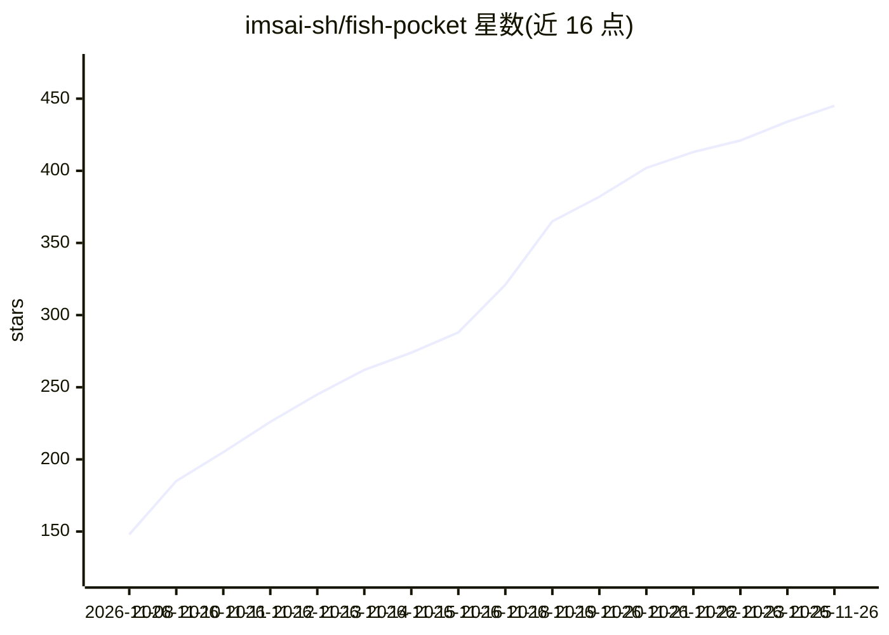

# imsai-sh/fish-pocket

⭐ 445 · Swift · NOASSERTION · 推送 2026-11-25 · [GitHub](https://github.com/imsai-sh/fish-pocket) · [官网](https://apps.apple.com/cn/app/fish-pocket/id6830703602) · 个人维护 · 中文 README

**在 iPhone/iPad 本机运行 DeepSeek Harness 的原生 iOS 客户端**

开源 iOS App，把 DSH（DeepSeek Harness）Agent 引擎以原生方式嵌入 App 在设备本机运行，无需电脑或服务器；界面用 SwiftUI 重写，功能对齐 DSH 官方 Web UI（对话、工具调用、审批、子智能体、插件等）。iOS 禁止子进程，项目将 Node、Python、libgit2、FFmpeg 以原生代码/动态框架嵌入，用线程替代进程。智能体可通过连接器使用日历、健康、照片等本机能力，配合第三方开源 iCTRL 操控其他 App；另提供 Bot 模式、Mini Apps、远程管理电脑上的 Codex/Claude Code/DSH 会话。App Store/TestFlight 分发，也可源码编译。

## 筛选速览

| 维度 | 判定 | 备注 |
|---|---|---|
| AI 角色 | `ai-native` | 本体是模型或模型工具 |
| 许可风险 | `none` | NOASSERTION |
| 部署形态 | `library` | 以包/库形式分发 |
| 模型依赖 | locked-api |  |
| 硬件要求 | — | 无带数字的原话,不猜 |
| 安装摩擦 | `medium` | 含编译或系统依赖之一 |
| 成熟度 | — | 结构信号不足 |

## 能力要点

- DSH 引擎嵌入 App 本机运行，会话和工作区留在设备上
- Node 24/Python 3.15/libgit2/FFmpeg 以原生代码嵌入，不模拟 Linux 虚拟机
- 通过系统框架桥接调用日历、提醒、健康、照片、地图等本机能力
- 对 DSH 社区前 50 插件抽样测试，42 个直接可用

## 适用场景

- 在手机上随时跑编码/日常智能体任务，不开电脑
- 让智能体读写日历提醒、处理照片等本机数据
- 用 Bot 团队定时执行联网查询和消息推送
- 在手机上跟进电脑和服务器的 Codex/Claude Code 会话

## 场景标签

`编码 Agent` `AI 助手` · 领域:编码与开发

## 证据(README 行号)

> L7:  本机运行不靠电脑，不靠服务器，不是网页套壳。引擎就跑在 App 里，每个页面都用 SwiftUI 重写，iPhone 和 iPad 都是原生体验。
> L60: - **功能对齐官方 Web UI：** 对话、工具调用、文件编辑、搜索、计划模式、审批、子智能体、智能体团队协作、定时任务和插件，DSH 官方 Web UI 能做的这里都能做。新会话选「创造模式」，还能让智能体替你写插件。
> L151: iOS 不允许 App 创建子进程，也不允许运行下载的二进制。所以这里不模拟 Linux 虚拟机，而是把 Node、Python 这些运行时以原生代码嵌进 App，再用 DSH 自己的服务接缝换掉“执行世界”。引擎文件一行都没改

## 星数曲线

2026-11-08 148 → 2026-11-26 445（+297）

---
*卡片 v1 · prompt 1.4 · 生成 2026-11-25 · 置信度 mid · 依据 README sha `fa2f0d625a80` · [字段定义](../../DATASET.md)*
