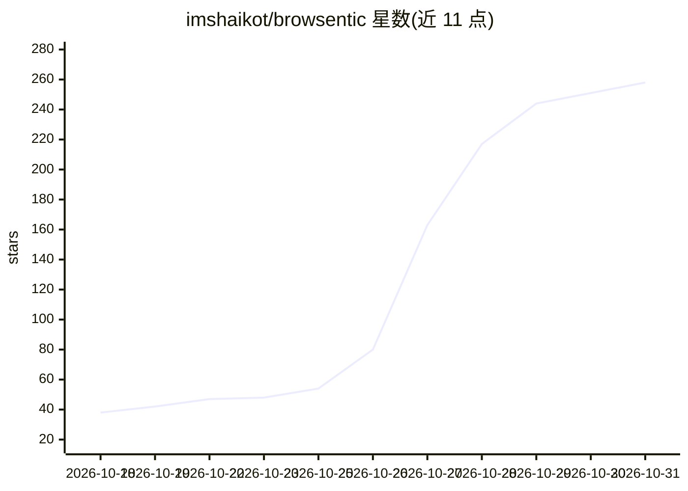

# imshaikot/browsentic

⭐ 258 · TypeScript · Apache-2.0 · 推送 2026-10-27 · [GitHub](https://github.com/imshaikot/browsentic) · [官网](https://browsentic.com) · 个人维护

**浏览器代理侧挂工具：让已有 agent CLI 驱动你登录中的浏览器**

浏览器扩展加本地 Bridge 的组合：扩展通过本地 WebSocket 连接 Browsentic Bridge，Bridge 调起用户已登录的 agent CLI（Claude Code、Codex、Antigravity 等），在用户真实的 Chrome、Edge、Firefox 等浏览器中执行页面操作。提供侧边栏展示每步动作，关键操作需人工批准，页面凭据对 agent 封存。另带可选 MCP server，供任意 MCP 客户端驱动同一浏览器。声称 50+ 确定性页面工具，无 API key、无云、本地运行。macOS/Windows 有桌面安装器，也可经 npx 安装；Windows 应用与 Android 驱动标注为实验性。

## 筛选速览

| 维度 | 判定 | 备注 |
|---|---|---|
| AI 角色 | `ai-ecosystem` | LLM/agent 周边工具 |
| 许可风险 | `permissive` | Apache-2.0 |
| 部署形态 | `library` | 以包/库形式分发 |
| 模型依赖 | — | README 未给出锁定关系 |
| 硬件要求 | — | 无带数字的原话,不猜 |
| 安装摩擦 | `low` | 无编译、无系统依赖或容器化 |
| 成熟度 | `idea` | |

## 能力要点

- 扩展经本地 WebSocket 连 Bridge，Bridge 调起用户已有 agent CLI（Claude Code/Codex 等 8 种）
- 可选 MCP server，多个 MCP 客户端可共享同一浏览器
- 侧边栏逐步展示动作，关键操作等待人工批准；页面凭据在 agent 可见前封存
- 兼容 Chrome/Edge/Firefox/Brave/Arc，全部绑定 127.0.0.1

## 适用场景

- 让已订阅的 agent CLI 在我登录态的浏览器里替我完成表单、上传下载等任务
- 通过 MCP 从 Claude Code、Cursor 或 Zed 驱动本地浏览器
- 在移动端 Chrome 上由 agent 代为执行操作（实验性）

## 场景标签

`浏览器自动化` · 领域:效率与自动化

## 证据(README 行号)

> L16: Your real, logged-in browser, driven from an AI side panel by the agent CLI you already have.
> L17: Also an optional MCP server, so any MCP client can drive the same browser.
> L103: You ──speak or type──> Extension ──local WebSocket──> Browsentic Bridge ──spawns──> your agent CLI
> L107: Any MCP client ──stdio──> browsentic mcp ──> the same Bridge ──> the same browser

## 星数曲线

2026-10-18 38 → 2026-10-31 258（+220）

---
*卡片 v1 · prompt 1.4 · 生成 2026-10-24 · 置信度 high · 依据 README sha `2eb959d0f746` · [字段定义](../../DATASET.md)*
