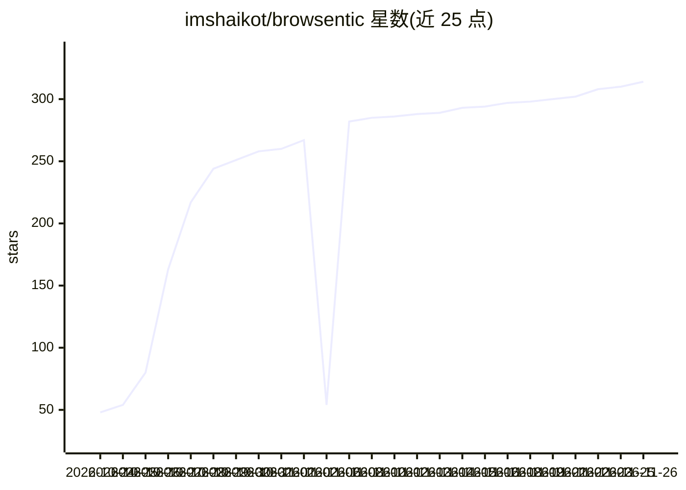

# imshaikot/browsentic

⭐ 314 · TypeScript · Apache-2.0 · 推送 2026-11-09 · [GitHub](https://github.com/imshaikot/browsentic) · [官网](https://browsentic.com) · 个人维护

**在已登录浏览器中驱动 agent CLI 的侧边栏浏览器自动化工具**

Browsentic 由浏览器扩展、本地 Bridge 和桌面应用组成：侧边栏把用户指令经本地 WebSocket 传给本机已有的 agent CLI（Claude Code、Codex 等），由其生成并执行页面操作，关键步骤需用户批准；另提供可选 MCP 服务器供任意 MCP 客户端驱动同一浏览器。支持 Chrome/Firefox/Edge/Brave/Arc，绑定 127.0.0.1，不要求 API key 或账号。安装依赖 Node.js 20+；Windows 应用标注为实验性。

## 筛选速览

| 维度 | 判定 | 备注 |
|---|---|---|
| AI 角色 | `ai-ecosystem` | LLM/agent 周边工具 |
| 许可风险 | `permissive` | Apache-2.0 |
| 部署形态 | `library` | 以包/库形式分发 |
| 模型依赖 | — | README 未给出锁定关系 |
| 硬件要求 | — | 无带数字的原话,不猜 |
| 安装摩擦 | `low` | 无编译、无系统依赖或容器化 |
| 成熟度 | — | 结构信号不足 |

## 能力要点

- 复用用户已登录的 agent CLI，无需 API key 与额外账号
- 提供 52 个页面工具，含导航、文件读写、上传下载、验证码处理
- 可选 MCP 服务器，多客户端可共享同一浏览器
- 受控动作需人工批准，凭据在 agent 读取前封存

## 适用场景

- 让 agent 在我已登录的浏览器里代为完成网页操作
- 在提交表单等关键动作前保留人工审批
- 通过 MCP 从 Claude Code、Cursor 或 Zed 驱动浏览器

## 场景标签

`浏览器自动化` · 领域:效率与自动化

## 证据(README 行号)

> L15: Your real, logged-in browser, driven from an AI side panel by the agent CLI you already have.
> L103: You ──speak or type──> Extension ──local WebSocket──> Browsentic Bridge ──spawns──> your agent CLI
> L68: The side panel runs on an agent CLI you are signed in to: Claude Code, Codex or another supported one. It uses the 

## 星数曲线

2026-10-24 48 → 2026-11-26 314（+266）

---
*卡片 v1 · prompt 1.4 · 生成 2026-11-25 · 置信度 high · 依据 README sha `36bd03939f62` · [字段定义](../../DATASET.md)*
