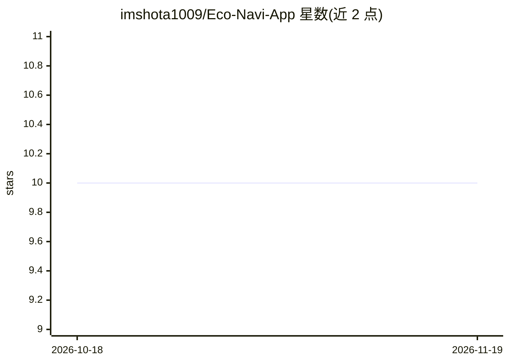

# imshota1009/Eco-Navi-App

⭐ 10 · HTML · Apache-2.0 · 推送 2026-07-04 · [GitHub](https://github.com/imshota1009/Eco-Navi-App) · [官网](https://imshota1009.github.io/Eco-Navi-App/) · 个人维护

**帮在日外国人拍照识别垃圾并按当地规则分类**

面向居住在日本的外国人的垃圾分类辅助 Web 应用：用户在浏览器打开 index.html，上传或拖放垃圾照片，应用调用 Google Gemini API 识别物品类别，并按用户所在市町村显示对应的分类方法；地区可通过名称输入（含预测）或 GPS 定位设置，并提供跳转当地政府官方分类指南页面的入口。另含生态积分与季节主题商店的游戏化功能，数据保存在浏览器 localStorage。使用需自行配置 Gemini API key；README 未提供服务器部署或包管理安装方式。

## 筛选速览

| 维度 | 判定 | 备注 |
|---|---|---|
| AI 角色 | `ai-native` | 本体是模型或模型工具 |
| 许可风险 | `permissive` | Apache-2.0 |
| 部署形态 | `None` |  |
| 模型依赖 | — | README 未给出锁定关系 |
| 硬件要求 | — | 无带数字的原话,不猜 |
| 安装摩擦 | `low` | 无编译、无系统依赖或容器化 |
| 成熟度 | — | 结构信号不足 |

## 能力要点

- 拍照调用 Google Gemini API 识别垃圾类别
- 按日本全国市町村显示对应分类规则
- GPS 或市町村名（含预测输入）设置地区
- 生态积分与季节主题商店的 localStorage 游戏化机制

## 适用场景

- 在日本生活不熟悉垃圾分类时拍照查询处理方法
- 查询所在市町村的官方垃圾分类指南页面
- 通过积分机制坚持进行正确垃圾分类

## 场景标签

`目标检测` · 领域:感知与多模态

## 证据(README 行号)

> L6: **AI技術を活用した、在留外国人向けゴミ分別サポートアプリ**
> L17: スマートフォンでゴミの写真を撮るだけで、AIがそのアイテムを識別し、お住まいの地域の自治体ルールに合わせた正しい分別方法を表示します。
> L43: - **AI / 機械学習**: Google Gemini API（画像認識用）

## 星数曲线

2026-10-18 10 → 2026-11-19 10（+0）

---
*卡片 v1 · prompt 1.4 · 生成 2026-11-19 · 置信度 high · 依据 README sha `2f57351c7065` · [字段定义](../../DATASET.md)*
