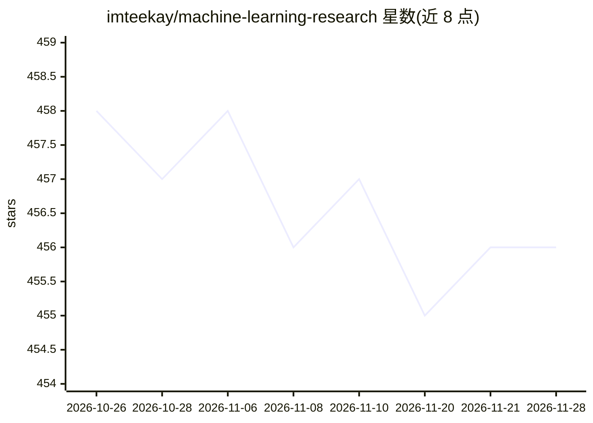

# imteekay/machine-learning-research

⭐ 456 · Jupyter Notebook · MIT · 推送 2026-11-27 · [GitHub](https://github.com/imteekay/machine-learning-research) · [官网](https://www.iamtk.co/ml-ai-learning-path) · 个人维护

**面向 AI/ML 学习者的课程、书籍与论文资源清单**

以目录形式组织的机器学习学习资源集合：按学习路线图（Roadmap）到数学基础（线性代数、统计、微积分、优化）、编程（Python、算法）、ML 工程、分布式系统、数据科学、机器学习、多模态与几何深度学习、深度学习等章节分类。条目为外部课程、书籍、论文、视频与博客的链接列表，部分条目带葡萄牙语资源，本身不包含可运行代码或安装流程。

## 筛选速览

| 维度 | 判定 | 备注 |
|---|---|---|
| AI 角色 | `ai-knowledge` | 知识聚合/清单类 |
| 许可风险 | `permissive` | MIT |
| 部署形态 | `None` |  |
| 模型依赖 | — | README 未给出锁定关系 |
| 硬件要求 | — | 无带数字的原话,不猜 |
| 安装摩擦 | `low` | 无编译、无系统依赖或容器化 |
| 成熟度 | — | 结构信号不足 |

## 能力要点

- 按学习路线组织的分类条目：数学/编程/ML 工程/深度学习等
- 收录课程、书籍、论文、视频、博客多形态外部资源
- 含多模态与几何深度学习专题章节
- 含少量葡萄牙语资源条目

## 适用场景

- 为零基础转行机器学习规划学习路径
- 按专题查找深度学习与图神经网络的学习材料
- 查找数学基础（线代/统计/微积分）的入门课程

## 场景标签

`精选清单` `教程课程` · 领域:学习与行业

## 证据(README 行号)

> L5: ## Table of Contents
> L9: - Machine Learning Roadmap 2022
> L118: ## Artificial Intelligence

## 星数曲线

2026-10-26 458 → 2026-11-28 456（-2）

---
*卡片 v1 · prompt 1.4 · 生成 2026-11-27 · 置信度 high · 依据 README sha `eb739df1b6b0` · [字段定义](../../DATASET.md)*
