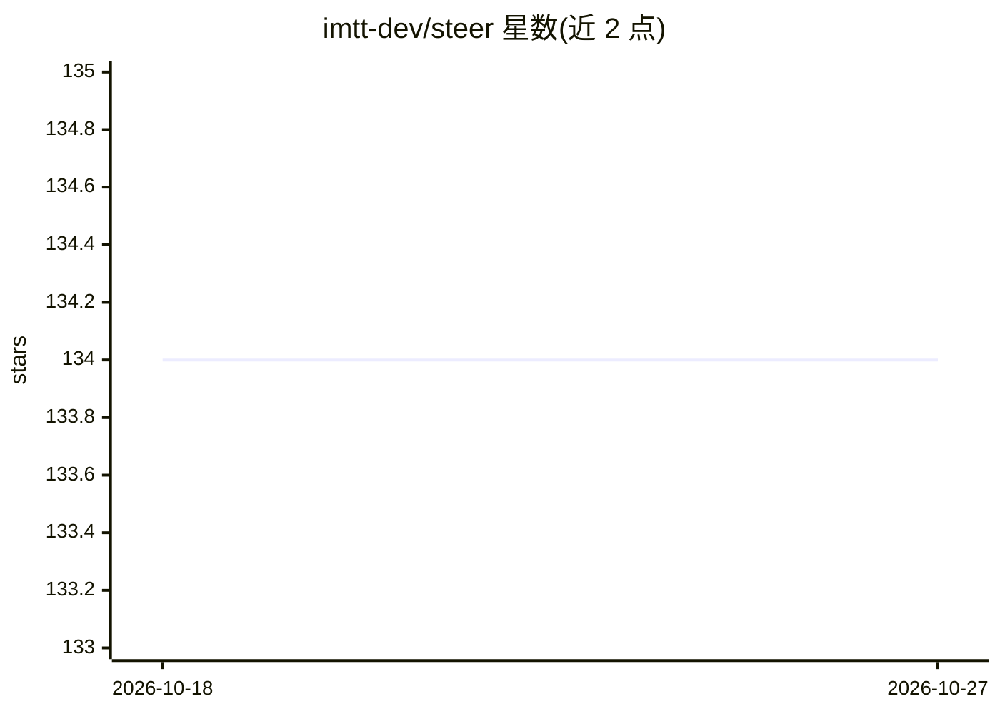

# imtt-dev/steer

⭐ 134 · Python · MIT · 推送 2026-01-19 · [GitHub](https://github.com/imtt-dev/steer) · [官网](https://pypi.org/project/steer-sdk/) · 组织维护

**AI Agent 输出拦截与可靠性策略层：拦截失败、教学修复**

面向运行自主 agent 的开发者，Steer 以 Agent Service Mesh 形式在应用入口处对框架（如 PydanticAI）做全局打补丁，或以装饰器方式注入校验规则。运行时按确定性规则拦截 agent 输出：JSON 结构守卫、PII 脱敏、歧义时强制澄清、基于香农熵的 Slop 过滤。失败响应可在本地 Mission Control UI 中通过 Catch→Teach→Fix 流程转为规则，并可导出 DPO 对比数据对供 trl/unsloth 训练。进程内运行，验证开销 <5ms，核心逻辑零依赖、不外发数据。

## 筛选速览

| 维度 | 判定 | 备注 |
|---|---|---|
| AI 角色 | `ai-ecosystem` | LLM/agent 周边工具 |
| 许可风险 | `permissive` | MIT |
| 部署形态 | `library` | 以包/库形式分发 |
| 模型依赖 | — | README 未给出锁定关系 |
| 硬件要求 | — | 无带数字的原话,不猜 |
| 安装摩擦 | `low` | 无编译、无系统依赖或容器化 |
| 成熟度 | — | 结构信号不足 |

## 能力要点

- Catch→Teach→Fix 循环：拦截失败输出并经 UI 教学后生效修复规则
- 四类 Reality Locks：JSON 结构守卫、PII 安全守卫、逻辑歧义守卫、基于香农熵的 Slop 过滤
- 将拦截/教学响应对导出为 DPO 训练数据（steer export --format dpo，兼容 trl/unsloth）
- 进程内校验 <5ms 开销，本地优先，核心验证逻辑零外部 API 依赖

## 适用场景

- 为自主 agent 拦截幻觉、协议漂移与结构破损的输出
- 通过 UI 教学将运行时失败沉淀为可复用规则
- 把生产失败转化为 DPO 偏好对训练数据
- 在 RAG 或 SQL 分析 agent 上强制引用与安全协议

## 场景标签

`LLM 可观测性` · 领域:评测与运维

## 证据(README 行号)

> L30: Steer functions as an **Agent Service Mesh**. It decouples your reliability policy from your application logic, all
> L48: Steer provides zero-touch reliability for frameworks like PydanticAI. Patch the framework at your application entry

## 星数曲线

2026-10-18 134 → 2026-10-27 134（+0）

---
*卡片 v1 · prompt 1.4 · 生成 2026-10-23 · 置信度 high · 依据 README sha `97a414183ced` · [字段定义](../../DATASET.md)*
