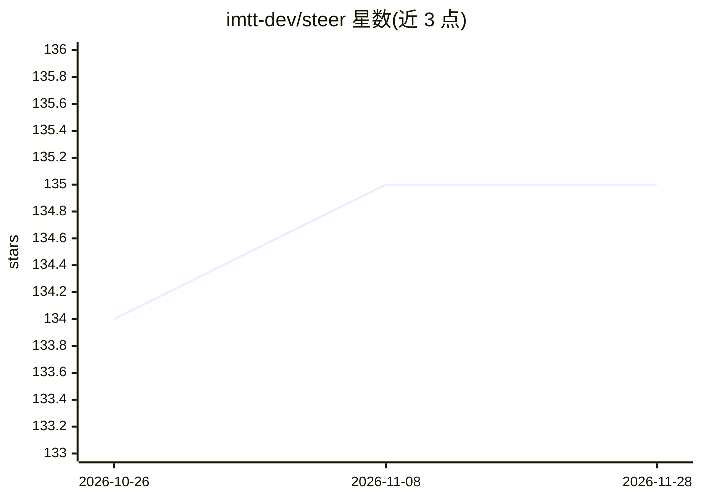

# imtt-dev/steer

⭐ 135 · Python · MIT · 推送 2026-11-05 · [GitHub](https://github.com/imtt-dev/steer) · [官网](https://pypi.org/project/steer-sdk/) · 个人维护

**为 AI Agent 提供运行时可靠性与输出校验的 Python 层**

以 Python SDK 形式提供的 Agent 可靠性中间层：拦截 LLM 输出中的幻觉与协议漂移，通过 JSON 结构校验、PII 泄露拦截、歧义检测、基于 Shannon 熵的风格过滤等 Judge 组件阻断不合格响应，并在仪表盘上以 Catch→Teach→Fix 流程固化规则。进程内运行、本地数据库、宣称 <5ms 验证开销、零外部依赖；还可将拦截与修正响应对导出为 DPO 训练数据。安装为 pip install steer-sdk，含 steer init/steer ui 命令。

## 筛选速览

| 维度 | 判定 | 备注 |
|---|---|---|
| AI 角色 | `ai-ecosystem` | LLM/agent 周边工具 |
| 许可风险 | `permissive` | MIT |
| 部署形态 | `library` | 以包/库形式分发 |
| 模型依赖 | — | README 未给出锁定关系 |
| 硬件要求 | — | 无带数字的原话,不猜 |
| 安装摩擦 | `low` | 无编译、无系统依赖或容器化 |
| 成熟度 | — | 结构信号不足 |

## 能力要点

- 运行时拦截幻觉与协议漂移，阻断不合格输出并记录原因码
- 提供 JSON 结构、PII、歧义、AI 风格（熵值）等多种校验器
- Mission Control UI 支持 Catch→Teach→Fix 规则固化流程
- 可将拦截/修正响应对导出为 DPO 训练数据（trl/unsloth 格式）

## 适用场景

- 为生产环境 Agent 拦截格式错误或含 PII 的响应
- 通过中心策略统一治理多个框架上的 Agent
- 将线上失败案例转化为 DPO 偏好对用于微调

## 场景标签

`LLM 可观测性` `微调` · 领域:评测与运维

## 证据(README 行号)

> L5:  The Active Reliability Layer for AI Agents.
> L28: Steer functions as an **Agent Service Mesh**. It decouples your reliability policy from your application logic, all
> L40: pip install steer-sdk

## 星数曲线

2026-10-26 134 → 2026-11-28 135（+1）

---
*卡片 v1 · prompt 1.4 · 生成 2026-11-28 · 置信度 high · 依据 README sha `7ba8e88a53ed` · [字段定义](../../DATASET.md)*
