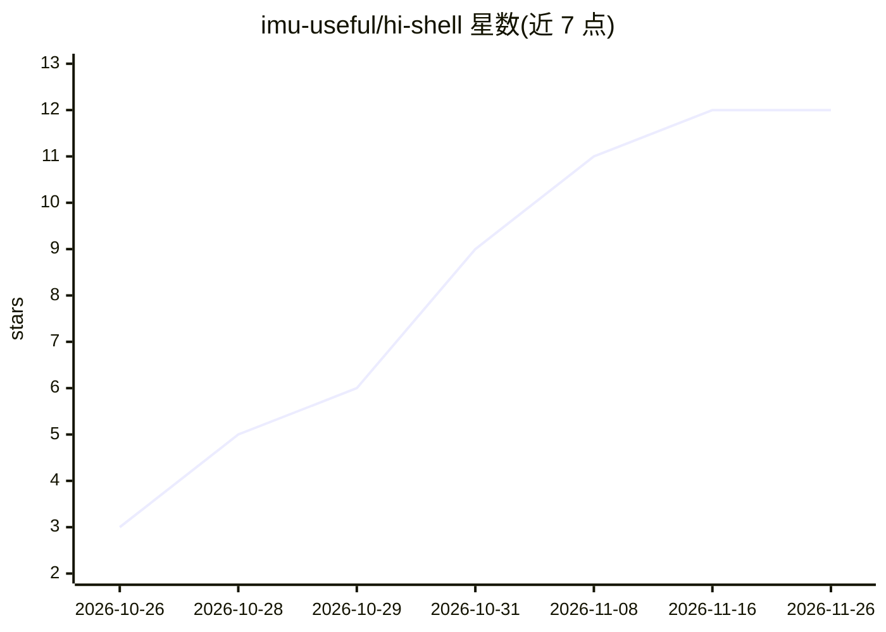

# imu-useful/hi-shell

⭐ 12 · QML · GPL-2.0 · 推送 2026-11-23 · [GitHub](https://github.com/imu-useful/hi-shell) · [官网](https://t.me/tux_emp) · 个人维护

**面向 Hyprland 的 Material 3 桌面 shell，内置 AI 聊天**

基于 Quickshell 构建的 Arch Linux + Hyprland 桌面 shell，GPL-2.0 许可，界面支持英文与俄文。功能包括可配置栏、应用启动器、AI 侧边栏聊天（流式回答、模型选择、token/费用统计）、区域截图/OCR/录屏、专注模式、屏幕时间统计、动态壁纸与 matugen 取色主题。AI 部分通过 claude CLI 接入 Claude，也支持多家 API key 服务与本地 Ollama。提供脚本安装器、pacman 包（PKGBUILD）与 NixOS 说明，仅 Arch 路径经过测试。

## 筛选速览

| 维度 | 判定 | 备注 |
|---|---|---|
| AI 角色 | `ai-enhanced` | 去掉 AI 部分产品仍成立 |
| 许可风险 | `viral` | GPL-2.0 |
| 部署形态 | `library` | 以包/库形式分发 |
| 模型依赖 | local-ok | 支持本地模型 |
| 硬件要求 | — | 无带数字的原话,不猜 |
| 安装摩擦 | `medium` | 含编译或系统依赖之一 |
| 成熟度 | — | 结构信号不足 |

## 能力要点

- AI 侧边栏聊天：流式回答、代码块复制、模型选择器、token/费用统计
- 通过 matugen 从壁纸生成 Material 3 配色，支持动态视频壁纸
- 专注模式：番茄钟、屏蔽应用与站点、统计与成就
- Quick install 脚本、PKGBUILD 打包与 NixOS 路径说明

## 适用场景

- 为 Arch Linux + Hyprland 配一套 Material 3 风格桌面
- 在桌面侧边栏直接与多个 AI 服务对话
- 用专注模式与屏幕时间统计管理使用习惯
- 以预设文件保存并分享整套配置与配色

## 场景标签

`OCR` `AI 助手` · 领域:对话与助手

## 证据(README 行号)

> L3: **A Material 3 Expressive desktop shell for Hyprland — with AI built in.**
> L25: |✨ **AI**|Quick palette ( Super + Y ) and a full chat in the left sidebar: streamed answers, code blocks with copy 
> L62: Arch Linux + Hyprland **0.56+** (the integration file uses the Lua config).

## 星数曲线

2026-10-26 3 → 2026-11-26 12（+9）

---
*卡片 v1 · prompt 1.4 · 生成 2026-11-18 · 置信度 mid · 依据 README sha `d3df6b4e283e` · [字段定义](../../DATASET.md)*
