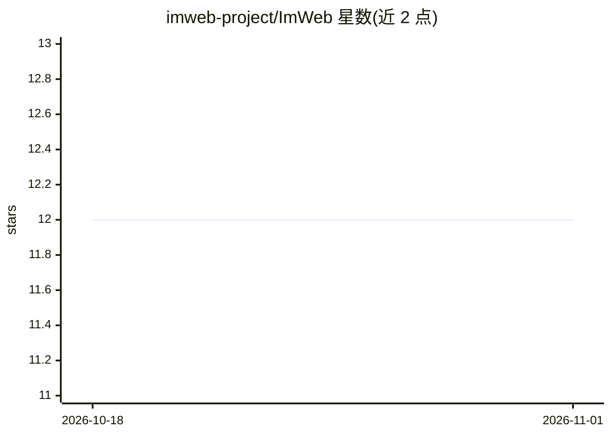

# imweb-project/ImWeb

⭐ 12 · JavaScript · NOASSERTION · 推送 2026-10-31 · [GitHub](https://github.com/imweb-project/ImWeb) · [官网](https://imweb.image-ine.org) · 个人维护

**浏览器端实时视频合成乐器，Image/ine 的现代化重制版**

在浏览器中对 1990 年代 STEIM 的 Image/ine 视频合成乐器进行重制，基于 Three.js、Vite 与原生 WebGL shader 构建。功能覆盖多种输入源（摄像头、影片、3D 场景、SDF 光线步进、Rutt-Etra 扫描处理器等）、效果链、MIDI/OSC/手柄控制映射、自动化与状态管理、音频磁带引擎。内置 AI 层支持七个提供商（含本地 Ollama），可从自然语言生成参数状态与 GLSL shader，API key 保存在浏览器内。运行需 Node 18+，提供在线演示。

## 筛选速览

| 维度 | 判定 | 备注 |
|---|---|---|
| AI 角色 | `ai-enhanced` | 去掉 AI 部分产品仍成立 |
| 许可风险 | `none` | NOASSERTION |
| 部署形态 | `library` | 以包/库形式分发 |
| 模型依赖 | local-ok | 支持本地模型 |
| 硬件要求 | — | 无带数字的原话,不猜 |
| 安装摩擦 | `medium` | 含编译或系统依赖之一 |
| 成熟度 | — | 结构信号不足 |

## 能力要点

- 多种视频输入源与实时 GLSL shader 合成信号链
- MIDI/OSC/手柄/LFO 等多来源参数控制映射（OSC Learn/Gamepad Learn）
- AI 层支持七个提供商含本地 Ollama：自然语言生成参数状态与 GLSL shader
- Project→Bank→State 层级的现场演出状态管理

## 适用场景

- 现场视听演出中实时合成与处理视频信号
- 用 AI 从自然语言描述生成合成状态或 shader
- 通过 MIDI/OSC 控制器操纵视频参数进行即兴表演

## 场景标签

`图像视频处理` · 领域:感知与多模态

## 证据(README 行号)

> L11: **ImWeb is Image/ine — reimagined** — The legendary real-time video synthesis instrument created by Tom Demeyer and
> L169: Built into the instrument, not beside it — and with no backend: API keys stay in your browser.
> L171: - **Seven providers** — Anthropic, Google Gemini, OpenAI, OpenRouter, DeepSeek, Kimi, and **Ollama running fully l

## 星数曲线

2026-10-18 12 → 2026-11-01 12（+0）

---
*卡片 v1 · prompt 1.4 · 生成 2026-11-01 · 置信度 high · 依据 README sha `f28a482100b9` · [字段定义](../../DATASET.md)*
