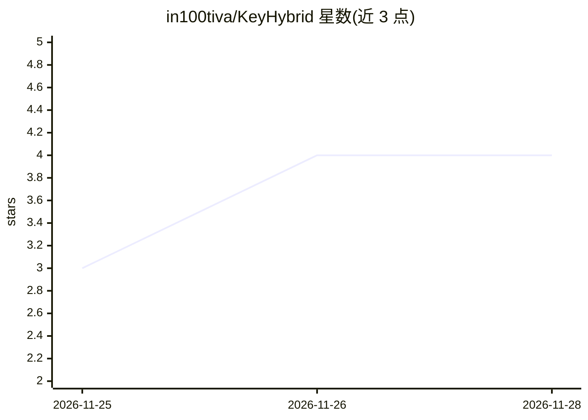

# in100tiva/KeyHybrid

⭐ 4 · Go · MIT · 推送 2026-11-27 · [GitHub](https://github.com/in100tiva/KeyHybrid) · [官网](https://in100tiva.github.io/KeyHybrid/) · 个人维护

**本地 AI 密钥保险库与 OpenAI 兼容网关，避免真实密钥泄露**

KeyHybrid 是一个桌面密钥保险库，集中保存 OpenRouter、Google Gemini、Anthropic 等 AI 提供商的 API 密钥，并在本地 127.0.0.1:8090 暴露 OpenAI 兼容网关。代理/agent 只使用别名形式的虚拟令牌（kh-<alias>），真实密钥不出现在 .env、shell 历史或代码中。安全机制包括 SQLite AES-256-GCM 加密、DPAPI/Secret Service 集成、RAM 中按需解密，以及模型 404 时重路由到 openrouter/auto 的回退。提供网关二进制、GHCR 容器镜像和桌面安装包（.deb/.msi），MIT 许可。

## 筛选速览

| 维度 | 判定 | 备注 |
|---|---|---|
| AI 角色 | `ai-ecosystem` | LLM/agent 周边工具 |
| 许可风险 | `permissive` | MIT |
| 部署形态 | `desktop` | 安装包/桌面程序 |
| 模型依赖 | locked-api |  |
| 硬件要求 | — | 无带数字的原话,不猜 |
| 安装摩擦 | `low` | 无编译、无系统依赖或容器化 |
| 成熟度 | — | 结构信号不足 |

## 能力要点

- OpenAI 兼容网关运行在 http://127.0.0.1:8090/v1，客户端用虚拟令牌 kh-<alias> 鉴权
- 零知识本地保险库：AES-256-GCM 存储 + DPAPI/Secret Service，仅在 HTTPS 调用瞬间在 RAM 解密
- 仅接受 loopback Host 的防护以应对 DNS rebinding
- 提供多平台二进制、GHCR 容器镜像与桌面安装包

## 适用场景

- 为本地 AI agent 分发虚拟令牌，避免真实 API 密钥散布在 .env 和脚本中
- 统一管理多个提供商密钥，切换提供商时不修改多处配置
- 以 Docker 方式在本地运行 OpenAI 兼容端点

## 场景标签

`网络安全` `模型网关` · 领域:Agent 开发

## 证据(README 行号)

> L16: > **Em 30 segundos:** um cofre local que guarda as chaves reais dos provedores de IA e expõe um gateway compatível 
> L18: O **KeyHybrid** é um cofre desktop para chaves de API de IA (**OpenRouter, Google Gemini, Anthropic**) combinado co

## 星数曲线

2026-11-25 3 → 2026-11-28 4（+1）

---
*卡片 v1 · prompt 1.4 · 生成 2026-11-24 · 置信度 high · 依据 README sha `717cd8151c1a` · [字段定义](../../DATASET.md)*
