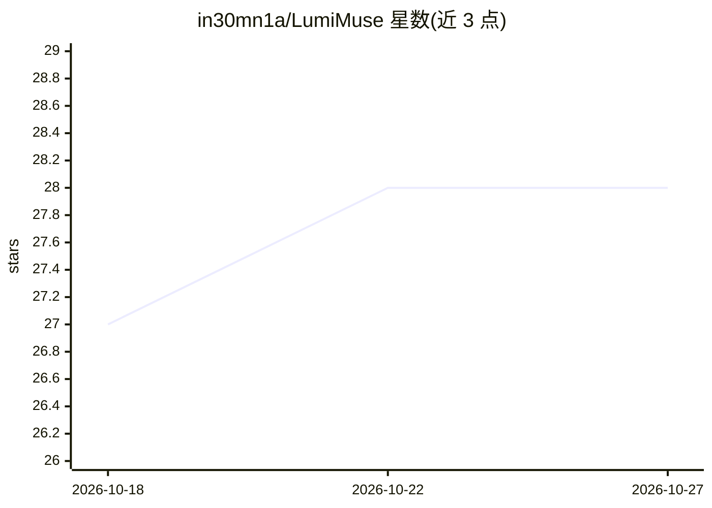

# in30mn1a/LumiMuse

⭐ 28 · JavaScript · MIT · 推送 2026-10-18 · [GitHub](https://github.com/in30mn1a/LumiMuse) · 个人维护 · 中文 README

**本地自部署的 AI 角色扮演/陪伴应用，带长期记忆与生图**

基于 Next.js 16 + React 19 + TypeScript + SQLite 的轻量级 AI 角色扮演/陪伴系统。用户可创建角色（性格、开场白、示例对话、生图标签），通过兼容 OpenAI Chat Completions 格式的模型接口进行流式聊天。内置长期记忆系统（提取、整理、归档、向量检索、token 预算装箱注入）与现实时间注入，支持 SD WebUI/NovelAI/ComfyUI 生图。数据存本机 SQLite，支持 npm 本地运行与 Docker Compose 部署，公网部署需设访问密码，容器以非 root 用户运行。

## 筛选速览

| 维度 | 判定 | 备注 |
|---|---|---|
| AI 角色 | `ai-native` | 本体是模型或模型工具 |
| 许可风险 | `permissive` | MIT |
| 部署形态 | `self-host` | docker 或自建部署 |
| 模型依赖 | — | README 未给出锁定关系 |
| 硬件要求 | — | 无带数字的原话,不猜 |
| 安装摩擦 | `low` | 无编译、无系统依赖或容器化 |
| 成熟度 | — | 结构信号不足 |

## 能力要点

- 长期记忆系统：自动提取、AI 整理/归档、向量检索与 token 预算装箱注入
- 兼容 OpenAI Chat Completions 格式的多供应商配置，聊天中可临时切模型
- 内置 SD WebUI / NovelAI / ComfyUI / 自定义 API 生图，图片带版本历史
- 数据自持有：SQLite + 本地文件，支持导入导出与 Docker 部署，含 SSRF 防护与访问密码

## 适用场景

- 和自建角色长期相处，让 TA 记住我们的关系与经历
- 自部署一个数据留在本地的私人 AI 陪伴空间
- 在聊天中直接生成角色场景图片
- 在手机、平板等多端继续与角色对话

## 场景标签

`聊天机器人` `Agent 记忆` `图像生成` · 领域:Agent 开发

## 证据(README 行号)

> L27: LumiMuse 是一个轻量级 AI 角色扮演 / 陪伴系统，带长期记忆、现实时间注入、原生生图、数据导入导出和 Docker 部署支持。
> L31: 你可以创建角色，给 TA 性格、背景、开场白、示例对话和生图标签；也可以让 TA 在聊天中慢慢记住关于你、你们关系和共同经历的细节。数据全部留在本地或你自己的服务器。

## 星数曲线

2026-10-18 27 → 2026-10-27 28（+1）

---
*卡片 v1 · prompt 1.4 · 生成 2026-10-26 · 置信度 high · 依据 README sha `5e5b4eed8b03` · [字段定义](../../DATASET.md)*
