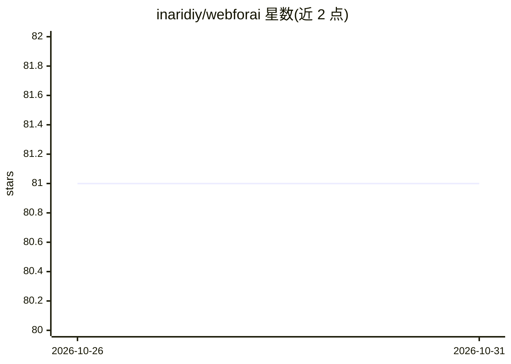

# inaridiy/webforai

⭐ 81 · TypeScript · Apache-2.0 · 推送 2026-10-29 · [GitHub](https://github.com/inaridiy/webforai) · [官网](https://webforai.dev) · 个人维护

**将 HTML 转为 Markdown 的 TypeScript 库/CLI/托管 API，供人与 AI agent 使用**

提供库、CLI（含 Agent Skill）与托管爬取 API 三种形态。Reader 模式提取页面正文（类似 Mozilla Readability），Agent 模式额外附加 Links 区段供 agent 决定下一步访问页面，token 用量约为整页转换的一半。保留代码块语言、GFM 表格，KaTeX/MathJax 转为 LaTeX，可输出 YAML front matter 元数据。库为纯 TypeScript、无 Node 内建依赖，可在 Node.js、Cloudflare Workers 与浏览器运行；浏览器渲染、代理与整站爬取需使用托管 API。

## 筛选速览

| 维度 | 判定 | 备注 |
|---|---|---|
| AI 角色 | `ai-ecosystem` | LLM/agent 周边工具 |
| 许可风险 | `permissive` | Apache-2.0 |
| 部署形态 | `library` | 以包/库形式分发 |
| 模型依赖 | — | README 未给出锁定关系 |
| 硬件要求 | — | 无带数字的原话,不猜 |
| 安装摩擦 | `low` | 无编译、无系统依赖或容器化 |
| 成熟度 | — | 结构信号不足 |

## 能力要点

- Reader/Agent 两种模式，Agent 模式附链接区段供 agent 导航，token 约为整页的一半
- 库零 Node 内建依赖，运行于 Node.js / Cloudflare Workers / 浏览器
- CLI 附带 Agent Skill，可装入 Claude Code、Codex、pi 等 coding agent
- 代码块保留语言、KaTeX/MathJax 转 LaTeX、front matter 元数据输出

## 适用场景

- 把已有 HTML 转成 Markdown 用于阅读、摘要、RAG 与 embedding
- 让 AI agent 以更少 token 浏览网站并选择下一个页面
- 通过托管 API 爬取整站生成 Markdown 与 llms.txt

## 场景标签

`网页抓取` · 领域:效率与自动化

## 证据(README 行号)

> L7:  Any HTML to the cleanest Markdown, for humans and AI agents.
> L63: - **Agent mode** adds the `## Links` section — related, pagination, section and site navigation,
> L110: |**CLI** — `webforai-cli`|`npx webforai-cli <url>`|The shell, scripts and AI agents (it ships an Agent Skill). CLI

## 星数曲线

2026-10-26 81 → 2026-10-31 81（+0）

---
*卡片 v1 · prompt 1.4 · 生成 2026-10-25 · 置信度 high · 依据 README sha `cdac79fec546` · [字段定义](../../DATASET.md)*
