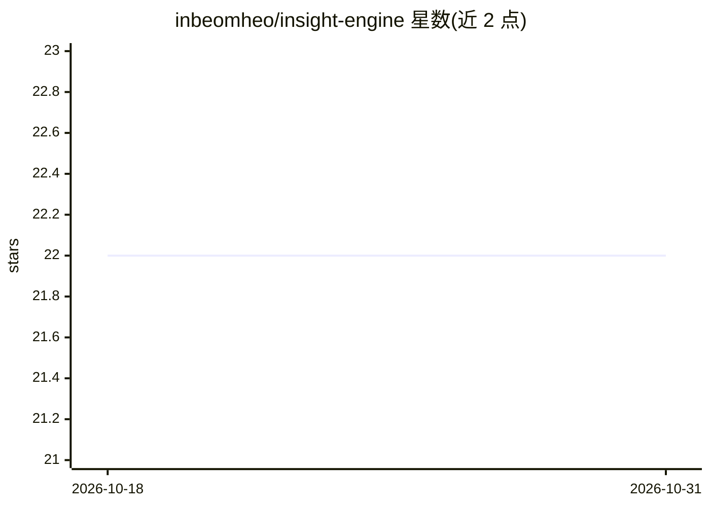

# inbeomheo/insight-engine

⭐ 22 · Python · MIT · 推送 2026-09-08 · [GitHub](https://github.com/inbeomheo/insight-engine) · 个人维护

**把 YouTube/文档/文本变成学习笔记与知识维基的 AI 学习引擎**

Flask + Next.js 全栈应用：读取 YouTube 视频、PDF/DOCX/PPTX 文档与音频，通过 CLIProxyAPI（OpenAI 兼容本地网关）生成 4 种输出（摘要、Q&A、测验、记忆卡），支持韩/英/日多语言与 [MM:SS] 时间戳引用。提供 ChromaDB RAG 知识引用、知识维基、团队工作空间、多代理流水线（Research→Writer→Editor→SEO）、网页钩子导出与间隔复习。仅支持单一模型 gpt-5.6-luna，需自建 CLIProxyAPI 网关与 Supabase，运行需双服务进程或 Docker Compose。

## 筛选速览

| 维度 | 判定 | 备注 |
|---|---|---|
| AI 角色 | `ai-native` | 本体是模型或模型工具 |
| 许可风险 | `permissive` | MIT |
| 部署形态 | `self-host` | docker 或自建部署 |
| 模型依赖 | — | README 未给出锁定关系 |
| 硬件要求 | — | 无带数字的原话,不猜 |
| 安装摩擦 | `low` | 无编译、无系统依赖或容器化 |
| 成熟度 | — | 结构信号不足 |

## 能力要点

- 4 种输出风格（摘要/Q&A/测验/记忆卡），支持批量 10 URL 与多风格同时生成
- 4 级字幕回退：youtube-transcript-api → watch 页解析 → Supadata → 本地 Whisper
- ChromaDB RAG 知识注入与知识维基、依据引用聊天
- 团队工作空间（Owner/Editor/Viewer）与内容审批流程

## 适用场景

- 把 YouTube 视频或课件文档整理成可复习的学习笔记和测验
- 团队共建知识维基并对生成内容做审批
- 对音频文件做转录并生成摘要

## 场景标签

`知识库管理` `文档问答` `语音识别` · 领域:知识与检索

## 证据(README 行号)

> L7: YouTube/문서/텍스트를 학습하고 LLMWiki형 지식 위키로 쌓는 AI 학습 엔진.
> L15: - **4가지 출력 스타일** — 요약, Q&A, 퀴즈, 리텐션 카드
> L38: - **RAG 지식 참조** — ChromaDB 벡터 스토어, 파일 업로드 → 생성 시 자동 주입

## 星数曲线

2026-10-18 22 → 2026-10-31 22（+0）

---
*卡片 v1 · prompt 1.4 · 生成 2026-10-27 · 置信度 high · 依据 README sha `c1f5356c22ef` · [字段定义](../../DATASET.md)*
