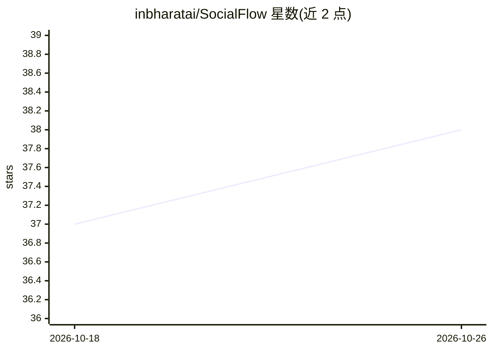

# inbharatai/SocialFlow

⭐ 38 · Python · 推送 2026-05-09 · [GitHub](https://github.com/inbharatai/SocialFlow) · 组织维护

**自托管的 AI 社媒自动化引擎：从选题到发布全流程代理**

面向希望自主运营社交媒体账号的用户/团队的开源自托管工具：6 个 Agent（Scout/Planner/Creator/Reviewer/Publisher/Analyst）组成流水线，自动抓取新闻与趋势、按平台生成内容与品牌图片、经质量门（凭据安全、品牌语气、声明校验）后通过 Playwright 浏览器自动化或 API 发布到 12 个平台。默认用 Ollama 本地模型免费生成内容，图像生成用 GPT Image 1.5（按量付费）。凭据以 Fernet 加密存储在本地。基于 FastAPI + SQLite + React，源码安装运行。

## 筛选速览

| 维度 | 判定 | 备注 |
|---|---|---|
| AI 角色 | `ai-native` | 本体是模型或模型工具 |
| 许可风险 | `none` | — |
| 部署形态 | `None` |  |
| 模型依赖 | local-ok | 支持本地模型 |
| 硬件要求 | — | 无带数字的原话,不猜 |
| 安装摩擦 | `medium` | 含编译或系统依赖之一 |
| 成熟度 | — | 结构信号不足 |

## 能力要点

- 6-Agent 流水线：选题→规划→创作→审核→发布→分析，按日程自动运行
- 支持 12 个发布平台，含 Playwright 浏览器自动化与 Webhook/API 通道
- 默认 Ollama 本地模型，可选 OpenAI/Anthropic/Gemini
- 品牌套件（颜色/Logo/字体/语气/禁忌风格）注入内容与图片生成，凭据 Fernet 本地加密

## 适用场景

- 让 AI 自动抓取热点并生成、排期、发布我的社媒内容
- 在本地自托管一套社媒运营系统，数据不出自己的机器
- 按品牌手册统一多平台内容与图片风格

## 场景标签

`多智能体` `浏览器自动化` `图像生成` `工作流自动化` · 领域:Agent 开发

## 证据(README 行号)

> L3: Self-hosted, open-source AI CMO that handles everything from news discovery to content generation, scheduling, and p
> L33: Scout → Planner → Creator → Reviewer → Publisher → Analyst
> L147: - **AI**: Ollama (local), OpenAI, Anthropic, Google Gemini

## 星数曲线

2026-10-18 37 → 2026-10-26 38（+1）

---
*卡片 v1 · prompt 1.4 · 生成 2026-10-25 · 置信度 high · 依据 README sha `655783688551` · [字段定义](../../DATASET.md)*
