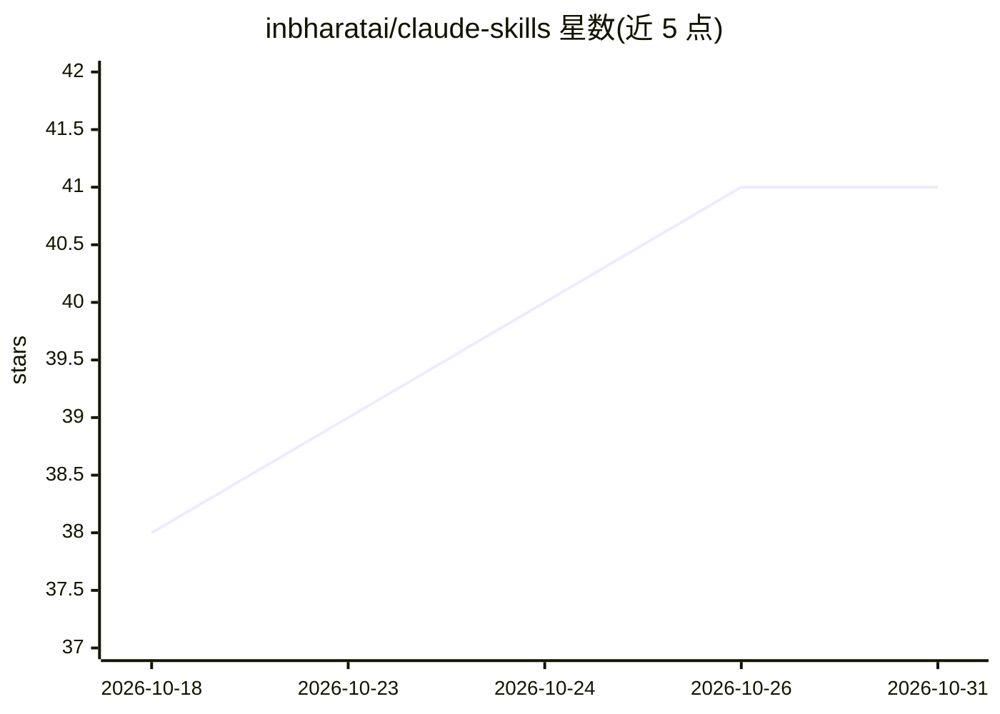

# inbharatai/claude-skills

⭐ 41 · Python · MIT · 推送 2026-03-14 · [GitHub](https://github.com/inbharatai/claude-skills) · 个人维护

**面向 Claude/Codex 的技能清单：183 个 SKILL.md 即插即用指令集**

收录 183 个以 SKILL.md 格式组织的 Claude 技能，按文档处理、创意设计、开发、数据分析、写作、商业生产力、教育等 12 个类别组织，覆盖文档生成（PDF/DOCX/PPTX）、代码评审、ETL 流水线、简历撰写、课程制作等任务。使用方式为将技能文件内容粘贴进 Claude.ai 对话或系统提示、通过 Anthropic API 注入 system prompt，或在 Claude Code 中加入 CLAUDE.md；MIT 许可，仓库声明零依赖。

## 筛选速览

| 维度 | 判定 | 备注 |
|---|---|---|
| AI 角色 | `ai-knowledge` | 知识聚合/清单类 |
| 许可风险 | `permissive` | MIT |
| 部署形态 | `self-host` | docker 或自建部署 |
| 模型依赖 | — | README 未给出锁定关系 |
| 硬件要求 | — | 无带数字的原话,不猜 |
| 安装摩擦 | `low` | 无编译、无系统依赖或容器化 |
| 成熟度 | — | 结构信号不足 |

## 能力要点

- 183 个生产可用技能，12 个类别组织
- SKILL.md 即插即用：粘贴到对话、API system prompt 或 CLAUDE.md 即生效
- 可拼接多个 SKILL.md 形成多技能上下文
- MIT 许可，零依赖

## 适用场景

- 给 Claude 注入特定领域的最佳实践与规范后再执行任务
- 为文档生成、代码评审、数据分析等工作挑选现成技能
- 参考技能模板自行构建新技能

## 场景标签

`提示工程` · 领域:Agent 开发

## 证据(README 行号)

> L22: **Skills** are plug-and-play instruction sets that make Claude an instant expert in any domain. Drop a `SKILL.md` i
> L26: This collection is the **most comprehensive Claude skills library on the internet** — 10× the size of the official 
> L31:  📂 12 Categories

## 星数曲线

2026-10-18 38 → 2026-10-31 41（+3）

---
*卡片 v1 · prompt 1.4 · 生成 2026-10-25 · 置信度 mid · 依据 README sha `04dc5b77774d` · [字段定义](../../DATASET.md)*
