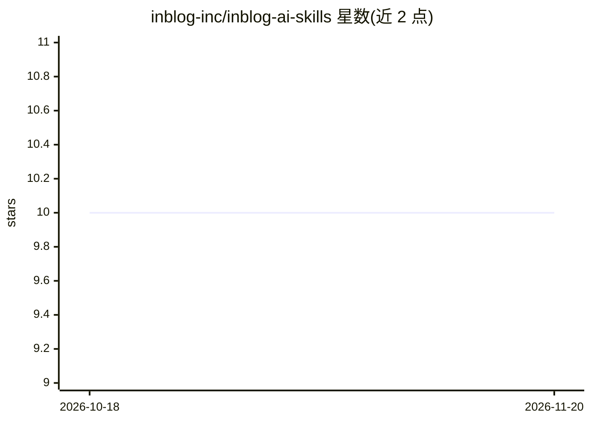

# inblog-inc/inblog-ai-skills

⭐ 10 · TypeScript · MIT · 推送 2026-07-28 · [GitHub](https://github.com/inblog-inc/inblog-ai-skills) · [官网](https://inblog.ai) · 组织维护

**为 inblog.ai 博客平台提供 AI 编程助手的技能包**

将基于提示词的技能文件安装到 AI 编程工具（Claude Code、Cursor、Copilot 等 37+ 工具）中，使其能通过自然语言管理 inblog.ai 博客：撰写 SEO 文章、管理内容、分析流量、上传图片、配置博客设置。依赖 @inblog/cli 执行底层操作，使用 .inblog/ 工作区目录持久化上下文。要求 inblog.ai Team 计划账号、API key 与 Node.js 18+。

## 筛选速览

| 维度 | 判定 | 备注 |
|---|---|---|
| AI 角色 | `ai-ecosystem` | LLM/agent 周边工具 |
| 许可风险 | `permissive` | MIT |
| 部署形态 | `library` | 以包/库形式分发 |
| 模型依赖 | — | README 未给出锁定关系 |
| 硬件要求 | — | 无带数字的原话,不猜 |
| 安装摩擦 | `low` | 无编译、无系统依赖或容器化 |
| 成熟度 | — | 结构信号不足 |

## 能力要点

- 17 个技能覆盖写作、SEO、分析、图片、策略到自主运营（autopilot）
- 支持 37+ AI 编程工具，经 skills.sh 或 npm 安装
- 图片获取含 Gemini 生成、Unsplash、截图与 Design Studio 四种方式
- .inblog/ 工作区持久化品牌、作者、内容计划与 API 缓存

## 适用场景

- 用自然语言让 AI 助手撰写并发布 SEO 优化的博客文章
- 让 AI 分析流量数据并生成内容优化建议
- 自动化管理博客配置、内链结构与内容更新

## 场景标签

`AI 写作` · 领域:内容生成

## 证据(README 行号)

> L3: AI coding assistant skills for inblog.ai blog management. Works with Claude Code, Cursor, GitHub Copilot, Codex, and
> L7: Installs prompt-based skills into your AI coding tool so it can manage your inblog blog: write SEO posts, manage con
> L124: 1. `npx @inblog/ai-skills` copies markdown skill files to your AI tool's config directory

## 星数曲线

2026-10-18 10 → 2026-11-20 10（+0）

---
*卡片 v1 · prompt 1.4 · 生成 2026-11-19 · 置信度 high · 依据 README sha `174fe8143b79` · [字段定义](../../DATASET.md)*
