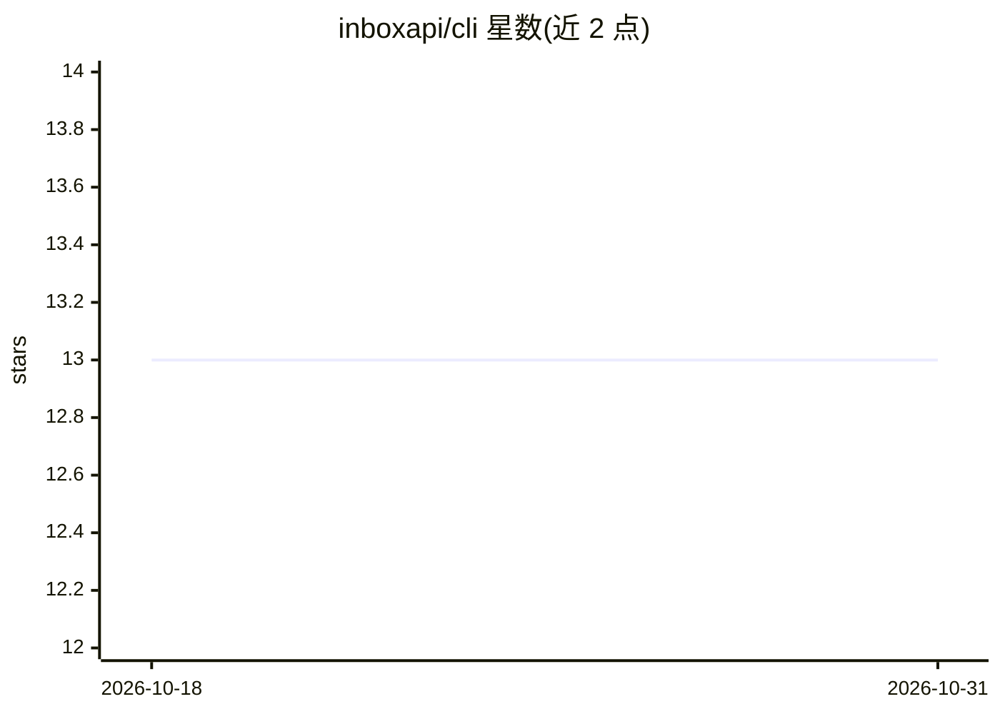

# inboxapi/cli

⭐ 13 · Rust · MIT · 推送 2026-09-22 · [GitHub](https://github.com/inboxapi/cli) · [官网](https://inboxapi.ai) · 组织维护

**给 AI agent 配独立邮箱的 MCP 桥接 CLI**

Rust 编写的命令行工具，作为本地桥接在 AI 客户端与 InboxAPI 云服务之间以 MCP（STDIO/JSON-RPC）协议通信，首次运行自动创建带独立邮箱地址的账户。AI agent 可发送、接收、回复、转发、搜索邮件及读取线程；另提供直接 CLI 子命令（send-email、search-emails 等）与面向 Claude Code/Codex/Gemini CLI/OpenCode 的 skills 和 hooks。限制：非事务性邮件服务，每账户每周最多向 5 个地址发送，新子域名邮件初期可能进垃圾箱。npm 全局安装，含 macOS/Linux/Windows 预编译二进制。

## 筛选速览

| 维度 | 判定 | 备注 |
|---|---|---|
| AI 角色 | `ai-ecosystem` | LLM/agent 周边工具 |
| 许可风险 | `permissive` | MIT |
| 部署形态 | `library` | 以包/库形式分发 |
| 模型依赖 | locked-api |  |
| 硬件要求 | — | 无带数字的原话,不猜 |
| 安装摩擦 | `medium` | 含编译或系统依赖之一 |
| 成熟度 | — | 结构信号不足 |

## 能力要点

- MCP STDIO 代理，兼容 Claude Desktop/Code、Gemini CLI、OpenCode、Codex 等 MCP 客户端
- 首次运行自动创建带独立邮箱地址的账户，无需邮件服务器与 SMTP 配置
- 除 MCP 外提供 send-email/search-emails 等直接 CLI 子命令，支持附件与 HTML 邮件
- 为 4 种 AI 编码 agent 安装 skills 与 Claude Code hooks（含发送守卫与活动日志）

## 适用场景

- 让 AI agent 用独立邮箱收发邮件，与个人邮箱隔离
- 给 Claude Code / Gemini CLI 等编码 agent 配置邮件工作流（如收件摘要、回复转发）
- 通过自然语言 skills 搜索邮件并生成活动摘要

## 场景标签

 · 领域:AI agent 工具/邮件

## 证据(README 行号)

> L23: The CLI acts as a local bridge between your AI client and the InboxAPI cloud service. It speaks the Model Context P
> L231: InboxAPI CLI also works as an MCP STDIO transport. Point your MCP client at the `inboxapi` binary:

## 星数曲线

2026-10-18 13 → 2026-10-31 13（+0）

---
*卡片 v1 · prompt 1.4 · 生成 2026-10-31 · 置信度 high · 依据 README sha `68e171139723` · [字段定义](../../DATASET.md)*
