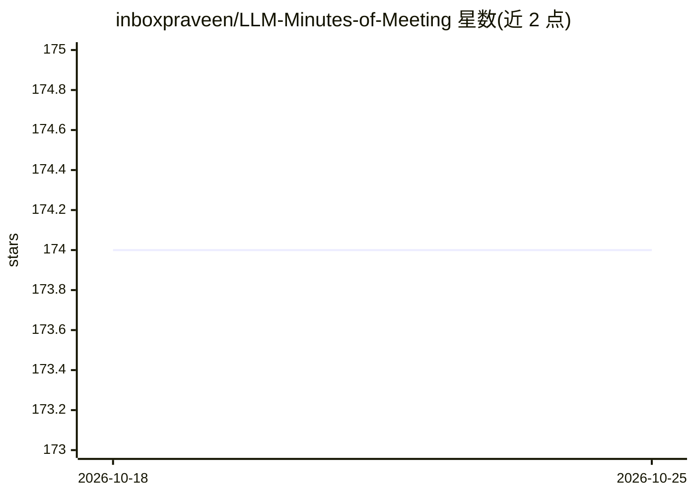

# inboxpraveen/LLM-Minutes-of-Meeting

⭐ 174 · Python · MIT · 推送 2026-09-07 · [GitHub](https://github.com/inboxpraveen/LLM-Minutes-of-Meeting) · [官网](https://inboxpraveen.github.io/projects/project-8.html) · 个人维护

**自托管会议纪要生成器：上传录音录像，出讲者标注转录与结构化纪要**

本地部署的 Web 应用：上传会议录音或视频，经所选转录服务（Deepgram、AssemblyAI、ElevenLabs Scribe、Sarvam AI、任意 OpenAI 兼容端点或本地 Whisper）转为讲者标注文本，再由任意 OpenAI 兼容 LLM（含 Ollama/LM Studio/vLLM 本地模型）生成会议纪要。长录音分段处理再合并；后台任务基于 Celery 与 Redis，提供进度、取消与重试。所有数据与加密的 API key 存储在本机目录。推荐 Docker Compose 部署，也可用 Python 3.10+、ffmpeg 与 Redis 从源码运行。

## 筛选速览

| 维度 | 判定 | 备注 |
|---|---|---|
| AI 角色 | `ai-native` | 本体是模型或模型工具 |
| 许可风险 | `permissive` | MIT |
| 部署形态 | `self-host` | docker 或自建部署 |
| 模型依赖 | local-ok | 支持本地模型 |
| 硬件要求 | — | 无带数字的原话,不猜 |
| 安装摩擦 | `low` | 无编译、无系统依赖或容器化 |
| 成熟度 | — | 结构信号不足 |

## 能力要点

- 讲者标注转录与 LLM 总结，转录与摘要服务均可在应用内切换
- 长录音分段转录合并，不受上传限制与上下文窗口约束
- 本地 Whisper 可选无 API key 转录，数据全部留在本机
- Celery/Redis 后台任务、健康检查端点与 Prometheus 指标

## 适用场景

- 把每周例会录像整理成分派到人的行动项纪要
- 在自有服务器上处理敏感会议录音，数据不出本机
- 无 API key 场景下用本地 Whisper + Ollama 完成全流程

## 场景标签

`语音识别` `AI 写作` · 领域:内容生成

## 证据(README 行号)

> L9: Upload a meeting recording, get structured minutes back. Transcription and summarisation run on
> L17: - **Your choice of transcription** — Deepgram, AssemblyAI, ElevenLabs Scribe, Sarvam AI, any
> L19: - **Your choice of LLM** — any OpenAI-compatible API: OpenAI, OpenRouter, Groq, Together, Fireworks,

## 星数曲线

2026-10-18 174 → 2026-10-25 174（+0）

---
*卡片 v1 · prompt 1.4 · 生成 2026-10-22 · 置信度 mid · 依据 README sha `d729ef57ddde` · [字段定义](../../DATASET.md)*
