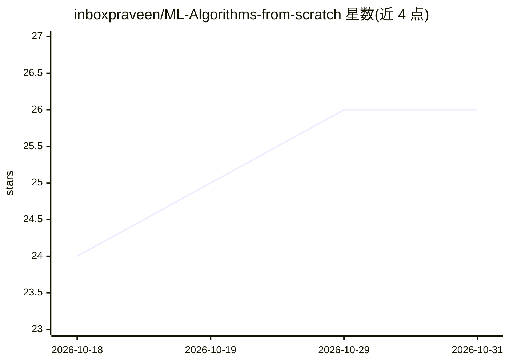

# inboxpraveen/ML-Algorithms-from-scratch

⭐ 26 · Python · GPL-3.0 · 推送 2026-10-28 · [GitHub](https://github.com/inboxpraveen/ML-Algorithms-from-scratch) · [官网](https://inboxpraveen.github.io/projects/project-5.html) · 个人维护

**28 种机器学习算法的 NumPy 教学实现，含数学讲解与可运行示例**

只用 Python 与 NumPy 从零实现 28 种机器学习算法（线性/逻辑回归、决策树、随机森林、SVM、 boosting 家族、t-SNE、UMAP、HMM、Prophet 等），面向学习算法原理的学生、开发者和准备技术面试的数据科学家。每个算法目录含带注释的 .py 实现与推导数学的 .md 文档；`python 文件名` 即在合成数据上训练并打印结果，无需下载数据集，NumPy 为唯一必需依赖。实现与 scikit-learn/SciPy 或原始论文做过对照，文档含 Simplifications 章节说明偏离原算法之处；README 声明以教学清晰性优先，生产场景应使用 scikit-learn、TensorFlow、PyTorch。

## 筛选速览

| 维度 | 判定 | 备注 |
|---|---|---|
| AI 角色 | `ai-native` | 本体是模型或模型工具 |
| 许可风险 | `viral` | GPL-3.0 |
| 部署形态 | `library` | 以包/库形式分发 |
| 模型依赖 | — | README 未给出锁定关系 |
| 硬件要求 | — | 无带数字的原话,不猜 |
| 安装摩擦 | `low` | 无编译、无系统依赖或容器化 |
| 成熟度 | — | 结构信号不足 |

## 能力要点

- 28 种算法仅依赖 NumPy 即可运行，内置合成数据的 Plug-and-Play Demo，结果有随机种子可复现
- 每个算法配套 .md 文档：公式推导并映射到实现代码行，附论文链接
- 实现与 scikit-learn/SciPy 或原始论文对照验证
- 统一 fit/predict/score 接口，并给出 5 阶段学习路径

## 适用场景

- 通过从零实现理解机器学习算法的数学与代码
- 准备数据科学/机器学习技术面试
- 按推荐顺序系统学习从回归到 boosting 的算法谱系

## 场景标签

`教程课程` · 领域:学习与行业

## 证据(README 行号)

> L13: This repository contains **clear, educational implementations** of essential machine learning algorithms built from
> L37: - **▶️ Runs Out of the Box**: `python "<any file>"` trains the model and prints results, NumPy only, no setup, no d
> L62: |#|Algorithm|Status|Documentation|

## 星数曲线

2026-10-18 24 → 2026-10-31 26（+2）

---
*卡片 v1 · prompt 1.4 · 生成 2026-10-27 · 置信度 mid · 依据 README sha `d56cc6b5f837` · [字段定义](../../DATASET.md)*
