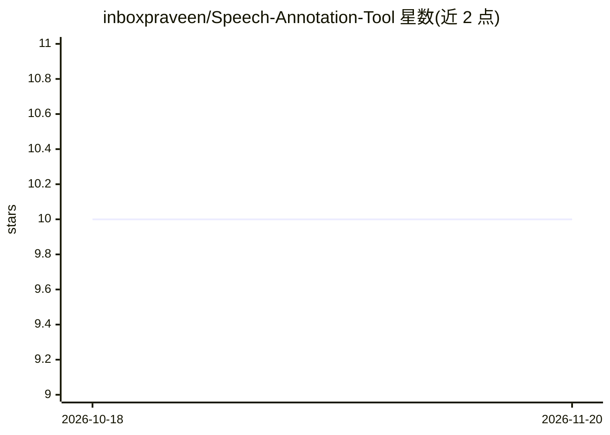

# inboxpraveen/Speech-Annotation-Tool

⭐ 10 · Python · MIT · 推送 2026-10-28 · [GitHub](https://github.com/inboxpraveen/Speech-Annotation-Tool) · [官网](https://inboxpraveen.github.io/projects/project-4.html) · 个人维护

**把音频文件夹转为审核后语音数据集的自托管工具**

自托管的语音标注工具：指定音频文件夹后，选择本地模型或托管 API 引擎进行扫描与转写，团队在浏览器中逐条校正文本、备注并通过/驳回，支持后台任务、断点续跑、账号与在线状态管理。导出 CSV、Excel、JSON Lines 或 Hugging Face 风格音频文件夹。Conda 或 Docker 部署，模型不从仓库内置，需在应用内下载；一次仅加载一个本地模型，可在笔记本 CPU 上运行。

## 筛选速览

| 维度 | 判定 | 备注 |
|---|---|---|
| AI 角色 | `ai-native` | 本体是模型或模型工具 |
| 许可风险 | `permissive` | MIT |
| 部署形态 | `self-host` | docker 或自建部署 |
| 模型依赖 | — | README 未给出锁定关系 |
| 硬件要求 | — | 无带数字的原话,不猜 |
| 安装摩擦 | `low` | 无编译、无系统依赖或容器化 |
| 成熟度 | — | 结构信号不足 |

## 能力要点

- 本地转写引擎覆盖 faster-whisper、onnx-asr（Parakeet/Canary）、transformers 管线、IndicConformer、Qwen3-ASR
- 托管 API 支持 OpenAI、Groq、Deepgram、ElevenLabs、Gemini、OpenRouter 及任意 OpenAI 兼容服务器
- 静音切分长录音、任务崩溃后从上一条记录继续
- 多人账号、编辑冲突防覆盖与在线状态显示

## 适用场景

- 把录音文件夹批量转写成可校正的语音数据集
- 团队协作审核与修正 ASR 转写文本
- 导出 Hugging Face 格式的语音训练数据

## 场景标签

`语音识别` · 领域:感知与多模态

## 证据(README 行号)

> L10: Turn a folder of audio into a reviewed speech dataset. Point the tool at a folder, pick a speech recognition engine
> L21: - Transcribes with local models (Whisper through faster-whisper, NVIDIA Parakeet and Canary through onnx-asr, any H

## 星数曲线

2026-10-18 10 → 2026-11-20 10（+0）

---
*卡片 v1 · prompt 1.4 · 生成 2026-11-19 · 置信度 high · 依据 README sha `029f125d5c07` · [字段定义](../../DATASET.md)*
