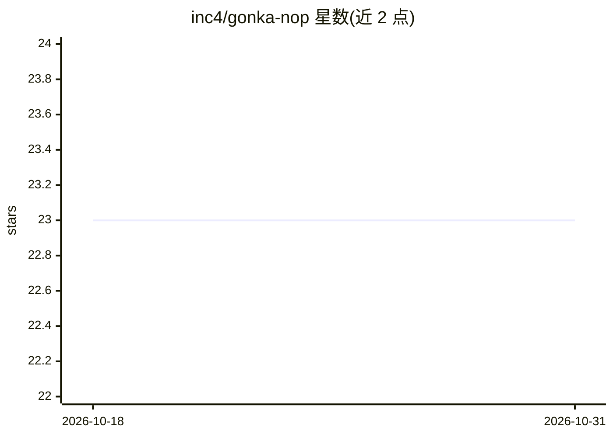

# inc4/gonka-nop

⭐ 23 · Go · MIT · 推送 2026-05-22 · [GitHub](https://github.com/inc4/gonka-nop) · 组织维护

**一条命令部署 Gonka GPU 推理节点的 CLI 工具**

Go 编写的命令行工具，用于在 Gonka 网络中部署 GPU 加速的 AI 推理节点：自动检测 GPU、安装 NVIDIA 驱动与 Container Toolkit、计算 TP/PP 配置、生成 docker-compose 与配置文件并部署容器。支持 full/network/mlnode 三种拓扑与多服务器分工，内置 ML 节点注册、链上治理委托、抵押管理、滚动更新与安全加固（端口绑定 127.0.0.1、DDoS 防护默认开启）。推理引擎采用 vLLM，模型按治理清单与 GPU 架构匹配。面向运行区块链+推理混合节点的运维人员。

## 筛选速览

| 维度 | 判定 | 备注 |
|---|---|---|
| AI 角色 | `ai-ecosystem` | LLM/agent 周边工具 |
| 许可风险 | `permissive` | MIT |
| 部署形态 | `self-host` | docker 或自建部署 |
| 模型依赖 | local-ok | 支持本地模型 |
| 硬件要求 | — | 无带数字的原话,不猜 |
| 安装摩擦 | `low` | 无编译、无系统依赖或容器化 |
| 成熟度 | — | 结构信号不足 |

## 能力要点

- 自动检测 GPU 并计算最优 TP/PP 配置，部署 vLLM 推理容器
- 三种部署拓扑（full/network/mlnode）与多服务器工作流
- 链上治理命令：按模型委托 PoC 权重、抵押存取、意图声明
- 默认安全加固：内部端口绑 127.0.0.1、DDoS 防护、GPU 显存上限防 OOM

## 适用场景

- 在 GPU 服务器上部署 Gonka 网络的 ML 推理节点
- 管理已注册 ML 节点的状态、镜像与滚动更新
- 参与链上治理：按模型选择运行或委托 PoC 权重

## 场景标签

`推理引擎` · 领域:训练与推理

## 证据(README 行号)

> L8: One-command CLI for deploying GPU-accelerated Gonka AI inference nodes. Auto-detects GPUs, configures NVIDIA runtime
> L63: Runs the vLLM inference engine on a dedicated GPU server. Connects to a remote network node.

## 星数曲线

2026-10-18 23 → 2026-10-31 23（+0）

---
*卡片 v1 · prompt 1.4 · 生成 2026-10-27 · 置信度 high · 依据 README sha `602f51811062` · [字段定义](../../DATASET.md)*
