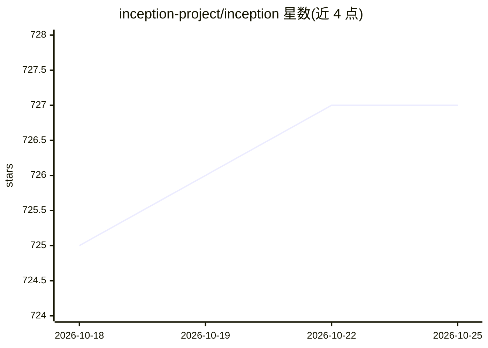

# inception-project/inception

⭐ 727 · Java · Apache-2.0 · 推送 2026-10-25 · [GitHub](https://github.com/inception-project/inception) · [官网](https://inception-project.github.io) · 组织维护

**面向研究团队的文本语义标注平台，带知识库链接与机器辅助建议**

基于 Java 的多层级文本标注平台：支持自定义标注体系（实体、关系、共指、句法、框架等），可加载 RDF/OWL/SKOS 等本体或查询远程 SPARQL 端点进行实体链接；内置推荐器随标注过程训练并通过主动学习提出建议，标注者接受前不落库。支持多人标注的黄金标准整合与标注者间一致性度量，提供 REST API、webhooks 与外部推荐器接入。可桌面单机安装或机构级服务器部署，导入 PDF/HTML/TEI，导出 UIMA CAS XMI/JSON 或 CoNLL-U。

## 筛选速览

| 维度 | 判定 | 备注 |
|---|---|---|
| AI 角色 | `ai-ecosystem` | LLM/agent 周边工具 |
| 许可风险 | `permissive` | Apache-2.0 |
| 部署形态 | `None` |  |
| 模型依赖 | — | README 未给出锁定关系 |
| 硬件要求 | — | 无带数字的原话,不猜 |
| 安装摩擦 | `low` | 无编译、无系统依赖或容器化 |
| 成熟度 | — | 结构信号不足 |

## 能力要点

- 多层标注（实体/关系/共指/句法/框架/文档标签）在浏览器中定义
- 推荐器随标注增量训练，主动学习聚焦低置信样本
- 本体实体链接：RDF/OWL/OBO/SKOS/Turtle 与远程 SPARQL，含 Wikidata/SNOMED CT/GO 等配置
- REST API、webhooks 与外部推荐器接入

## 适用场景

- 为语料库构建定义自定义标注体系并多人协作标注
- 把标注结果挂接到领域本体或远程知识库
- 多人标注整合为黄金标准并测量一致性

## 场景标签

`知识图谱` `科研工具` · 领域:知识与检索

## 证据(README 行号)

> L28: - **Get suggestions that improve while you work.** Recommenders train on what you have annotated so
> L35: - **Drive it from your own code.** REST API, webhooks, and your own models as

## 星数曲线

2026-10-18 725 → 2026-10-25 727（+2）

---
*卡片 v1 · prompt 1.4 · 生成 2026-10-21 · 置信度 mid · 依据 README sha `7eeb98145c9d` · [字段定义](../../DATASET.md)*
