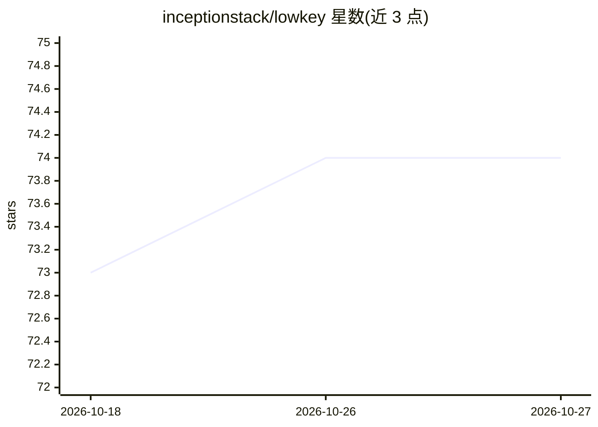

# inceptionstack/lowkey

⭐ 74 · Shell · Apache-2.0 · 推送 2026-10-11 · [GitHub](https://github.com/inceptionstack/lowkey) · 组织维护

**把多种自托管 AI 编程 Agent 一键部署到 AWS 的安装器**

面向拥有 AWS 管理权限的开发者的部署工具：通过 curl 一行命令交互式选择 agent 包、权限档位、实例规格，用 CloudFormation 在专用沙箱账号的 EC2 上部署 OpenClaw、Claude Code、Hermes、Codex CLI 等 10 种 agent 运行时。核心机制是 pack 架构：每个包自带安装脚本与 manifest，依赖由 registry.yaml 自动解析；bedrockify 基础包在 8090 端口提供 Bedrock 的 OpenAI 兼容代理。内置三种 IAM 权限档位区分 builder/只读/纯助手，部署后通过引导脚本配置告警、记忆、Telegram 等能力。限制：多数实验性包需 SSM 登录后手动完成认证。

## 筛选速览

| 维度 | 判定 | 备注 |
|---|---|---|
| AI 角色 | `ai-ecosystem` | LLM/agent 周边工具 |
| 许可风险 | `permissive` | Apache-2.0 |
| 部署形态 | `None` |  |
| 模型依赖 | locked-api |  |
| 硬件要求 | — | 无带数字的原话,不猜 |
| 安装摩擦 | `low` | 无编译、无系统依赖或容器化 |
| 成熟度 | `idea` | |

## 能力要点

- 10 种 agent pack（OpenClaw/Claude Code/Codex CLI 等）经 CloudFormation 部署到 EC2
- bedrockify 基础包提供 Amazon Bedrock 的 OpenAI 兼容代理
- builder/account_assistant/personal_assistant 三档 IAM 权限配置
- 部署后可用引导脚本配置告警、记忆搜索、Telegram/Discord/Slack 集成

## 适用场景

- 在隔离的 AWS 沙箱账号里运行有完整权限的编程 agent
- 给 AI agent 配置只读或纯 Bedrock 的受限权限档位
- 让 agent 24/7 在云端常驻并通过 Telegram/Discord 交互

## 场景标签

`编码 Agent` · 领域:编码与开发

## 证据(README 行号)

> L160: Lowkey uses a **pack-based architecture** for deploying different AI agent runtimes. Each pack is a self-contained
> L181: install.sh → picks pack → CloudFormation → EC2 instance

## 星数曲线

2026-10-18 73 → 2026-10-27 74（+1）

---
*卡片 v1 · prompt 1.4 · 生成 2026-10-24 · 置信度 high · 依据 README sha `8d1e715a65e1` · [字段定义](../../DATASET.md)*
