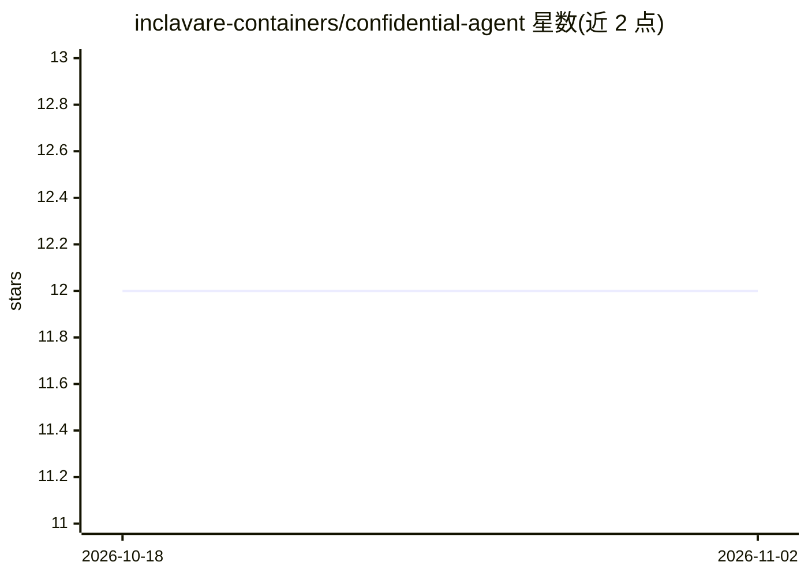

# inclavare-containers/confidential-agent

⭐ 12 · Shell · Apache-2.0 · 推送 2026-10-14 · [GitHub](https://github.com/inclavare-containers/confidential-agent) · 组织维护 · 中文 README

**基于 Intel TDX 的机密计算 AI Agent 部署方案**

面向需要在不可信云环境中部署 AI Agent 的用户：以 Profile 驱动的统一工作流管理镜像构建、阿里云 ECS 部署、本地 QEMU 开发、服务发现与远程证明，内置 OpenClaw AI Gateway、OpenClaw+vLLM、机密 MCP Server 三种 Profile。核心组件包括 Attestation Agent（TDX 远程证明）、Trustee（验证与密钥管理）、TNG（加密通信）；支持 challenge 与 trustee 两种机密资源分发模式，以及基于 Rekor 透明日志的参考值工作流。附带 cai-pep 工具沙箱，将 Agent 的 exec 调用放入 Docker 沙箱执行并记录审计日志。部署依赖阿里云 OSS/ECS 与 Intel TDX 机型。

## 筛选速览

| 维度 | 判定 | 备注 |
|---|---|---|
| AI 角色 | `ai-ecosystem` | LLM/agent 周边工具 |
| 许可风险 | `permissive` | Apache-2.0 |
| 部署形态 | `None` |  |
| 模型依赖 | local-ok | 支持本地模型 |
| 硬件要求 | — | 无带数字的原话,不猜 |
| 安装摩擦 | `medium` | 含编译或系统依赖之一 |
| 成熟度 | — | 结构信号不足 |

## 能力要点

- Profile 驱动的镜像构建/阿里云部署/本地 QEMU 开发统一工作流
- TDX 远程证明 + Trustee 密钥管理 + RATS-TLS 加密通信
- Rekor 透明日志参考值与 SLSA 供应链审计
- cai-pep 工具沙箱：策略限制 exec 命令并写入 journal 审计

## 适用场景

- 在公有云上以 TEE 隔离方式运行 AI Agent，防云厂商窥探
- 将 MCP Server 部署到独立 TDX 实例并经远程证明访问
- 对 Agent 镜像供应链做 Rekor/SLSA 审计
- 为 Agent 的工具调用加沙箱与审计

## 场景标签

 · 领域:机密计算/AI 基础设施

## 证据(README 行号)

> L3: 基于 Intel TDX 的机密计算 AI Agent 部署方案。Confidential Agent 使用 Profile 驱动的统一工作流管理镜像构建、阿里云部署、本地开发、服务发现和远程证明，支持 OpenClaw AI Ag
> L422: Confidential Agent 是一种运行在硬件级可信执行环境（TEE）中的 AI Agent 部署方案。它基于 Intel TDX（Trust Domain Extensions）技术，将 AI Agent 的执行环境与

## 星数曲线

2026-10-18 12 → 2026-11-02 12（+0）

---
*卡片 v1 · prompt 1.4 · 生成 2026-11-01 · 置信度 high · 依据 README sha `0e560a86e668` · [字段定义](../../DATASET.md)*
