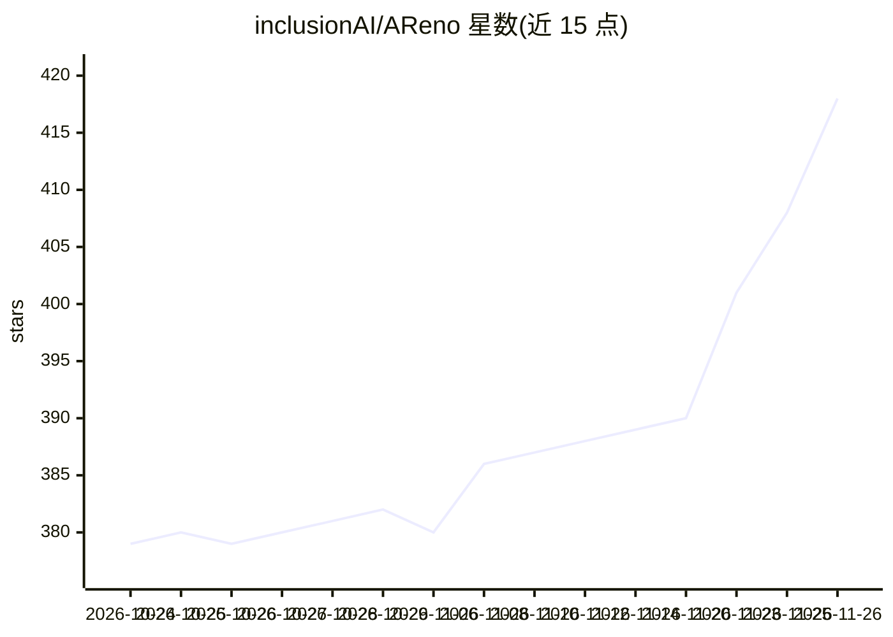

# inclusionAI/AReno

⭐ 418 · Python · Apache-2.0 · 推送 2026-11-25 · [GitHub](https://github.com/inclusionAI/AReno) · 组织维护 · 中文 README

**单节点 LLM RL 后训练工具包：训练、服务、agentic RL 一体**

由蚂蚁集团 ASystem 团队发起、社区维护的本地 LLM 后训练工具包，覆盖 RL（GRPO/GSPO）、SFT/DPO、服务与 agentic RL。采用自包含全栈设计，无外部训练或推理后端，通过 --algo 或 Python Trainer 类切换算法；提供 CLI、SDK、Dashboard 与本地运维 agent。支持 CUDA、Ascend NPU、Apple Silicon MLX 三种后端，Linux x86_64/aarch64 或 macOS arm64，Windows 经 WSL2 走 CUDA 路径。

## 筛选速览

| 维度 | 判定 | 备注 |
|---|---|---|
| AI 角色 | `ai-ecosystem` | LLM/agent 周边工具 |
| 许可风险 | `permissive` | Apache-2.0 |
| 部署形态 | `self-host` | docker 或自建部署 |
| 模型依赖 | — | README 未给出锁定关系 |
| 硬件要求 | — | 无带数字的原话,不猜 |
| 安装摩擦 | `low` | 无编译、无系统依赖或容器化 |
| 成熟度 | — | 结构信号不足 |

## 能力要点

- RL/SFT/DPO 算法经 --algo 标志切换，单节点运行无需集群
- CUDA、Ascend NPU、Apple Silicon MLX 三后端支持
- Agentic RL：agent 函数经本地 OpenAI 兼容代理返回轨迹用于训练
- 原生 LoRA/QLoRA，保存标准 PEFT 产物

## 适用场景

- 在单节点上从基座 checkpoint 训练到可服务模型
- 对 agent 任务做多轮 RL 后训练
- 在 Apple Silicon 本地跑小模型 RL 实验

## 场景标签

`强化学习` `微调` · 领域:训练与推理

## 证据(README 行号)

> L16: AReno is a local LLM post-training toolkit for RL, SFT/DPO-style training, serving, and agentic RL. It was original
> L29: - 🪶 **Lightweight**: one self-contained train/serve stack with CUDA, Ascend NPU, and Apple Silicon MLX backends.
> L43: AReno supports Linux (x86_64 or aarch64) with an NVIDIA GPU and CUDA-enabled

## 星数曲线

2026-10-24 379 → 2026-11-26 418（+39）

---
*卡片 v1 · prompt 1.4 · 生成 2026-11-25 · 置信度 high · 依据 README sha `820da6c3c18a` · [字段定义](../../DATASET.md)*
