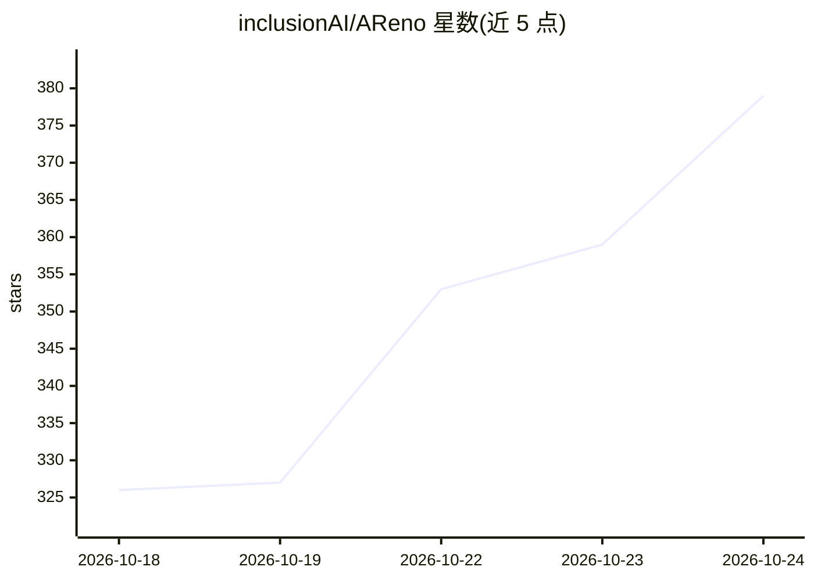

# inclusionAI/AReno

⭐ 380 · Python · Apache-2.0 · 推送 2026-10-23 · [GitHub](https://github.com/inclusionAI/AReno) · 组织维护 · 中文 README

**单节点本地 LLM 强化学习后训练工具包**

面向研究人员与开发者的本地 LLM 后训练工具包，支持 RL、SFT/DPO 风格训练、推理服务与 Agentic RL。自包含全栈设计，无需外部训练或推理后端，在单节点上完成从基座 checkpoint 到训练、服务模型的全流程。提供 Trainer SDK 与 CLI（areno train/serve/check/agent），支持 CUDA、昇腾 NPU（CANN/torch_npu）与 Apple Silicon MLX 后端，内置原生 LoRA/QLoRA、多模态、OpenAI 兼容代理与服务端点，可注册自定义算法与硬件后端。最初由蚂蚁集团 ASystem 团队开发，现由社区维护。

## 筛选速览

| 维度 | 判定 | 备注 |
|---|---|---|
| AI 角色 | `ai-ecosystem` | LLM/agent 周边工具 |
| 许可风险 | `permissive` | Apache-2.0 |
| 部署形态 | `self-host` | docker 或自建部署 |
| 模型依赖 | — | README 未给出锁定关系 |
| 硬件要求 | — | 无带数字的原话,不猜 |
| 安装摩擦 | `low` | 无编译、无系统依赖或容器化 |
| 成熟度 | — | 结构信号不足 |

## 能力要点

- 单节点自包含 train/serve 全栈，无需集群与外部后端
- CUDA / 昇腾 NPU / Apple Silicon MLX 三种硬件后端
- Agentic RL：agent 经本地 OpenAI 兼容代理返回显式轨迹并转为可训练样本
- 原生 LoRA / QLoRA（NF4、双量化、分页优化器），保存标准 PEFT 产物

## 适用场景

- 在单机上对 Qwen 等模型做 GRPO/GSPO/SFT 后训练
- 训练后直接以 OpenAI 兼容端点提供服务（含 LoRA 适配器）
- 运行 Agentic RL 实验（井字棋、SWE-bench 风格编码任务、DuelGrid）
- 用 areno agent 自然语言生成适配当前机器的训练命令

## 场景标签

`强化学习` `微调` `推理引擎` · 领域:训练与推理

## 证据(README 行号)

> L16: AReno is a local LLM post-training toolkit for RL, SFT/DPO-style training, serving, and agentic RL. It was original
> L20: AReno's mission is to make LLM RL **accessible** for a broad community of researchers and developers — so you can g

## 星数曲线

2026-10-18 326 → 2026-10-24 379（+53）

---
*卡片 v1 · prompt 1.4 · 生成 2026-10-21 · 置信度 mid · 依据 README sha `884c0bd5bd50` · [字段定义](../../DATASET.md)*
