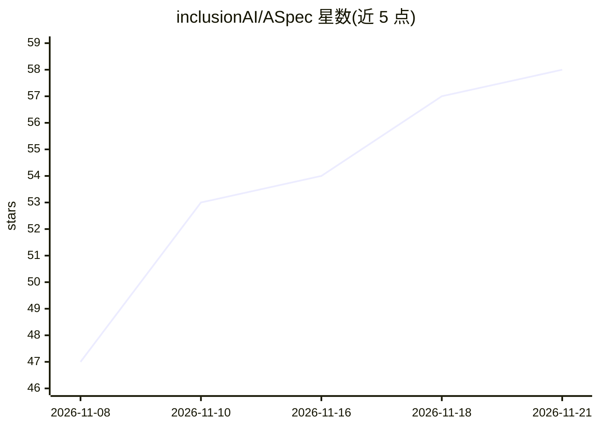

# inclusionAI/ASpec

⭐ 58 · Python · Apache-2.0 · 推送 2026-11-20 · [GitHub](https://github.com/inclusionAI/ASpec) · [官网](https://github.com/inclusionAI/ASpec) · 组织维护 · 中文 README

**面向投机采样草稿模型的高吞吐训练框架**

ASpec 是用于投机采样（speculative decoding）Draft 模型的训练框架，基于 TorchSpec 代码库开发。机制上优化 Draft 前向/反向与优化器执行，将 Target 特征生成与训练重叠，通过 GPU 张量通道传输数据，并支持多个独立 Draft 实验共享同一份兼容 Target 特征。支持 DSpark、DFlash、EAGLE3/4、native MTP 等草稿算法，Dense/Qwen MoE/Ling MoE 结构，以及序列打包与上下文并行。安装分两个环境：Draft 环境装 ling-aspec，Target 环境装 ling-aspec-target 并对 SGLang 打补丁；DFlash2 仍为实验性，需多 GPU（示例为 NVLink 双卡）。Apache 2.0 许可。

## 筛选速览

| 维度 | 判定 | 备注 |
|---|---|---|
| AI 角色 | `ai-ecosystem` | LLM/agent 周边工具 |
| 许可风险 | `permissive` | Apache-2.0 |
| 部署形态 | `library` | 以包/库形式分发 |
| 模型依赖 | — | README 未给出锁定关系 |
| 硬件要求 | — | 无带数字的原话,不猜 |
| 安装摩擦 | `low` | 无编译、无系统依赖或容器化 |
| 成熟度 | `idea` | |

## 能力要点

- Target 特征生成与 Draft 训练重叠执行，GPU 张量数据通道传输
- 一个 Target 支持多个并发 Draft 实验共享兼容特征，无共享优化器步屏障
- 支持 DSpark/DFlash/EAGLE3/EAGLE4/native MTP 草稿算法与 Qwen/Ling MoE 结构
- 序列打包、上下文并行与静态多节点训练（NVLink/TCP/RDMA）

## 适用场景

- 训练投机采样的草稿模型并导出评估
- 在长上下文场景下并行训练多个草稿实验对比算法
- 复用 Target 特征加速多组超参/结构对比实验

## 场景标签

`微调` · 领域:训练与推理

## 证据(README 行号)

> L7: ASpec is a high-throughput training framework for speculative decoding draft models. It optimizes
> L8: Draft forward, backward and optimizer execution, overlaps training with Target feature generation,
> L25: - **One Target, multiple concurrent Draft experiments.** Compare algorithms, structures or

## 星数曲线

2026-11-08 47 → 2026-11-21 58（+11）

---
*卡片 v1 · prompt 1.4 · 生成 2026-11-18 · 置信度 high · 依据 README sha `6139ae869b6c` · [字段定义](../../DATASET.md)*
