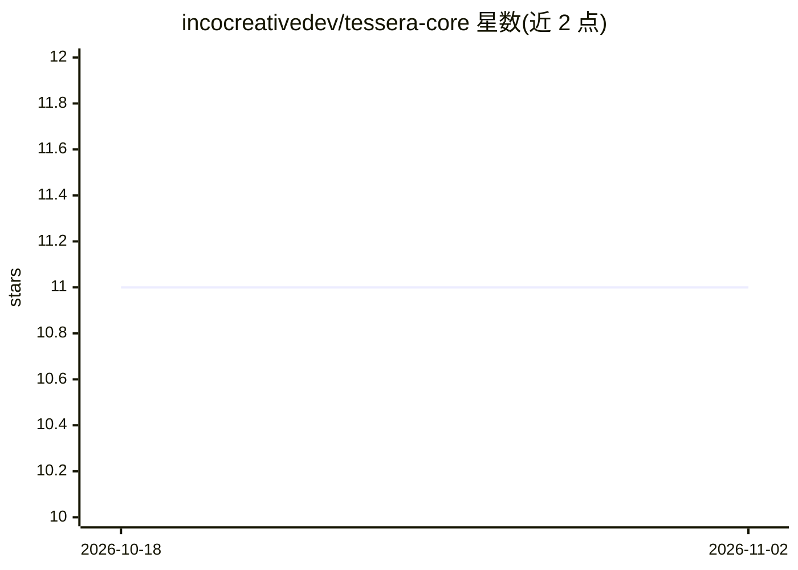

# incocreativedev/tessera-core

⭐ 11 · Python · NOASSERTION · 推送 2026-02-25 · [GitHub](https://github.com/incocreativedev/tessera-core) · [官网](https://github.com/incocreativedev/tessera-core) · 组织维护

**跨架构模型间知识迁移协议库：激活级表示传递**

以激活模式（而非权重）编码已训练模型的知识，经 2048 维 Universal Hub Space 的编码/解码对，将知识迁移到不同架构的未训练模型，并用 KL 散度漂移分衡量保真度。每架构只需一对编码器/解码器，新增架构为 O(1) 成本。已在 Transformer/MLP/Conv1D/LSTM 四族 20 组配对上基准测试（8 组正迁移、0 失败）。产出 TesseraToken（SafeTensors 与 TBF 二进制格式，支持量化与 HMAC），并含差分隐私机制。面向使用 PyTorch 的研究者与开发者。

## 筛选速览

| 维度 | 判定 | 备注 |
|---|---|---|
| AI 角色 | `ai-ecosystem` | LLM/agent 周边工具 |
| 许可风险 | `permissive` | NOASSERTION |
| 部署形态 | `library` | 以包/库形式分发 |
| 模型依赖 | — | README 未给出锁定关系 |
| 硬件要求 | `cpu-ok` | |
| 安装摩擦 | `low` | 无编译、无系统依赖或容器化 |
| 成熟度 | — | 结构信号不足 |

## 能力要点

- 激活级跨架构知识迁移，架构无关（不迁移权重）
- Universal Hub Space 线性扩展，新架构 O(1) 接入
- KL 散度漂移度量与 TBF 二进制 token（量化/HMAC/差分隐私）
- 四架构族 20 组基准矩阵，CPU 可运行

## 适用场景

- 把已训练小模型的知识迁移到不同架构的新模型
- 研究跨架构迁移的可行性与漂移预测
- 以紧凑 token 格式在模型间分发学习到的知识

## 场景标签

 · 领域:机器学习/模型互操作

## 证据(README 行号)

> L3: **An open protocol for AI-to-AI knowledge transfer.**
> L9: Tessera enables trained neural networks to transfer what they've learned to untrained models across completely diffe
> L11: Think of it as the missing "knowledge layer" in the AI stack — MCP connects models to tools, A2A coordinates agents

## 星数曲线

2026-10-18 11 → 2026-11-02 11（+0）

---
*卡片 v1 · prompt 1.4 · 生成 2026-11-02 · 置信度 high · 依据 README sha `ee46cce59394` · [字段定义](../../DATASET.md)*
