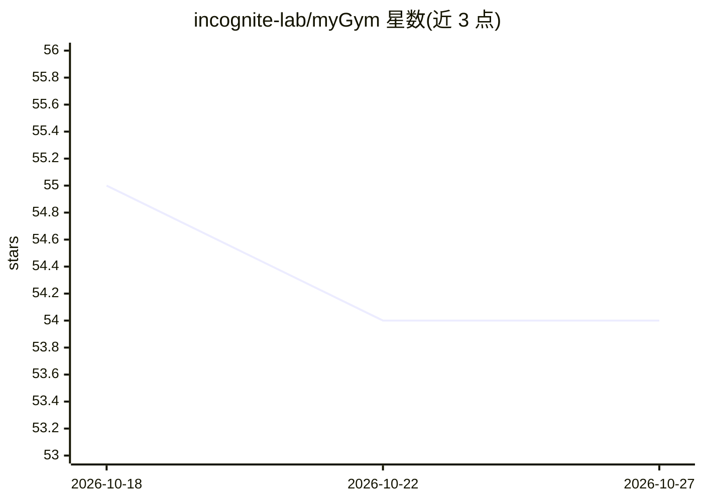

# incognite-lab/myGym

⭐ 54 · Python · MIT · 推送 2026-08-16 · [GitHub](https://github.com/incognite-lab/myGym) · [官网](https://mygym.readthedocs.io/en/latest/) · 组织维护

**机器人操作/导航任务的强化学习仿真与训练工具包**

面向机器人操作与导航领域神经网络快速原型开发的工具包：用户无需编码即可通过配置文件指定目标物体、由原子动作词汇（approach/grasp/drop 等）组成长时程任务，系统自动为各阶段配对奖励并构建任务；支持单任务内训练多个网络（multippo），可在 CPU/GPU 上训练。内置 taskchecker、oraculum 自动求解器等可行性检查工具，提供 show 命令可视化与测试训练结果。附带 G1、Tiago、Nico、Pepper 人形机器人及 Kuka、Panda、UR 等机械臂的预训练基线，兼容 Stable Baselines3 与 Gymnasium。由布拉格捷克技术大学 CIIRC 的 Incognite lab 团队维护。

## 筛选速览

| 维度 | 判定 | 备注 |
|---|---|---|
| AI 角色 | `ai-ecosystem` | LLM/agent 周边工具 |
| 许可风险 | `permissive` | MIT |
| 部署形态 | `library` | 以包/库形式分发 |
| 模型依赖 | — | README 未给出锁定关系 |
| 硬件要求 | — | 无带数字的原话,不猜 |
| 安装摩擦 | `low` | 无编译、无系统依赖或容器化 |
| 成熟度 | — | 结构信号不足 |

## 能力要点

- 配置文件方式免编码创建长时程多步任务，奖励自动配对
- 内置 taskchecker 与 oraculum 自动求解器验证任务可行性
- 预训练基线覆盖 G1/Tiago/Nico/Pepper 人形机器人与多种机械臂
- 兼容 Stable Baselines3 与 Gymnasium，可训练多网络

## 适用场景

- 为机器人抓取与放置任务训练强化学习策略
- 在人形机器人或机械臂上原型验证 visuomotor 网络
- 查看和基准测试已训练的机器人控制模型

## 场景标签

`强化学习` `模型训练` · 领域:训练与推理

## 证据(README 行号)

> L11: We introduce myGym, a toolkit suitable for fast prototyping of neural networks in the area of robotic manipulation 
> L15: There are also novel functions to automatize workflow. Load new objects and robots, check their physical functional
> L23: From myGym 3.10 there is Stable Baseline 3 and Gymnasium.

## 星数曲线

2026-10-18 55 → 2026-10-27 54（-1）

---
*卡片 v1 · prompt 1.4 · 生成 2026-10-24 · 置信度 high · 依据 README sha `8767314ce5df` · [字段定义](../../DATASET.md)*
