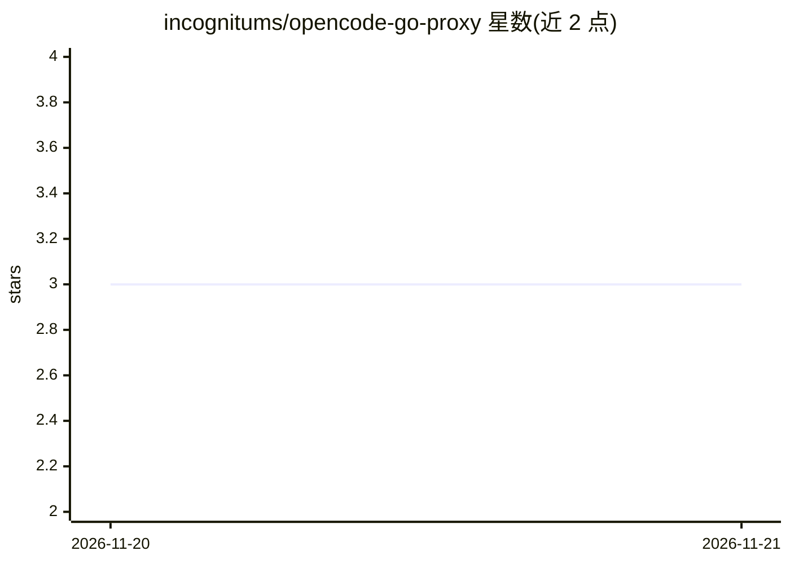

# incognitums/opencode-go-proxy

⭐ 3 · Python · MIT · 推送 2026-11-20 · [GitHub](https://github.com/incognitums/opencode-go-proxy) · 个人维护

**为第三方编码 Agent 接入 OpenCode Go 修复会话/鉴权与 prompt 缓存的本地代理**

本地运行的代理与 Windows 托盘程序，位于第三方编码 Agent（ZCode、Claude Code、Codex 等）与 OpenCode Go 网关之间：注入 x-opencode-session 会话头、按 OpenAI/Anthropic 两种 API 形状改写鉴权头、折叠重复的 /v1 路径段，并从 sha256(system+首条用户消息) 派生稳定会话 ID 使 prompt 缓存命中。提供统计浮窗、按天使用台账、端口自动回退与配置文件。代理本体为单文件 Node 脚本零依赖；托盘程序仅限 Windows，需 Python 及 pystray/pillow。

## 筛选速览

| 维度 | 判定 | 备注 |
|---|---|---|
| AI 角色 | `ai-ecosystem` | LLM/agent 周边工具 |
| 许可风险 | `permissive` | MIT |
| 部署形态 | `desktop` | 安装包/桌面程序 |
| 模型依赖 | — | README 未给出锁定关系 |
| 硬件要求 | — | 无带数字的原话,不猜 |
| 安装摩擦 | `low` | 无编译、无系统依赖或容器化 |
| 成熟度 | — | 结构信号不足 |

## 能力要点

- 注入会话头并派生稳定会话 ID，使 prompt 缓存命中（README 记录实测 99–100%）
- 同时接受 OpenAI 风格 /chat/completions、/responses 与 Anthropic 风格 /messages 请求
- 端口被占用时自动向上扫描并回写实际绑定端口
- 内置 --check 密钥校验、/__stats 统计接口与按天使用历史台账

## 适用场景

- 让 Claude Code/Codex 等工具通过 OpenCode Go 网关正常调用模型
- 降低长上下文会话的重复输入 token 计费
- 在 Windows 上以托盘方式常驻管理代理并查看用量统计

## 场景标签

 · 领域:LLM 基础设施/推理接入

## 证据(README 行号)

> L3: Local shim + Windows tray app that makes third-party coding agents (ZCode,
> L102: **API shapes it takes:** `POST /chat/completions` and `/responses` (OpenAI

## 星数曲线

2026-11-20 3 → 2026-11-21 3（+0）

---
*卡片 v1 · prompt 1.4 · 生成 2026-11-21 · 置信度 mid · 依据 README sha `8248022f5157` · [字段定义](../../DATASET.md)*
