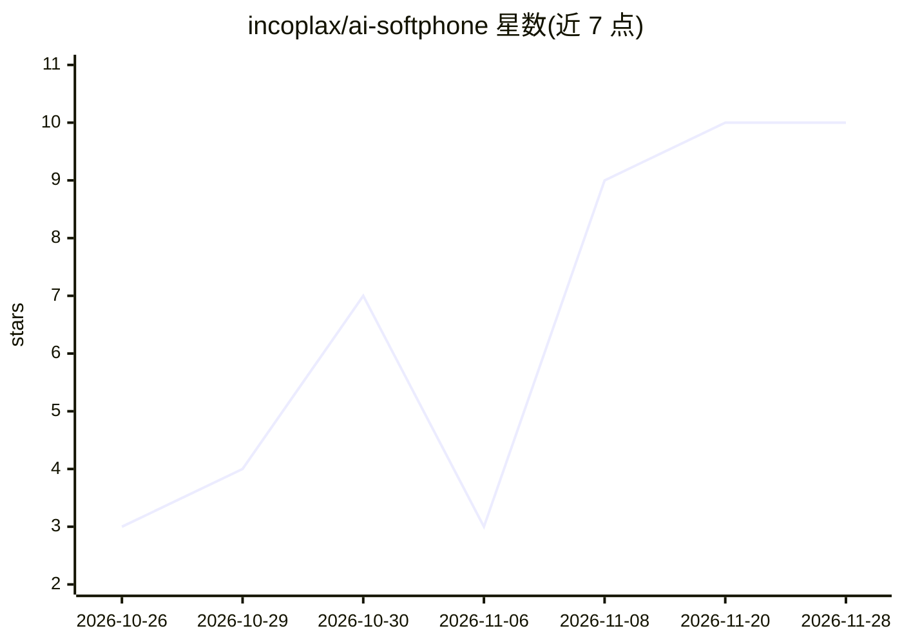

# incoplax/ai-softphone

⭐ 10 · C++ · GPL-2.0 · 推送 2026-10-17 · [GitHub](https://github.com/incoplax/ai-softphone) · 个人维护

**跨平台 SIP 软电话：通话录音、转写并生成纪要**

以 Qt/C++ 构建的桌面 SIP 软电话，覆盖多账号、多路通话、保持/静音/DTMF、转接、本地会议、TLS 信令与 SRTP 媒体等商务电话功能。AI 层对通话及系统声音（Zoom/Teams 等）录音并转写为文本，生成摘要、双方承诺、话题实体、标签、评分与翻译；通话进行中提供字幕、翻译与提示下一步话术的 prompter。支持 11 种语音识别器，LLM 走 OpenAI chat 形状（本地 Ollama/vLLM、OpenAI、Anthropic 等），可全程本地化运行；GPL-2.0-or-later。

## 筛选速览

| 维度 | 判定 | 备注 |
|---|---|---|
| AI 角色 | `ai-native` | 本体是模型或模型工具 |
| 许可风险 | `viral` | GPL-2.0 |
| 部署形态 | `library` | 以包/库形式分发 |
| 模型依赖 | local-ok | 支持本地模型 |
| 硬件要求 | — | 无带数字的原话,不猜 |
| 安装摩擦 | `medium` | 含编译或系统依赖之一 |
| 成熟度 | — | 结构信号不足 |

## 能力要点

- 通话中字幕、翻译与基于对方话语的 prompter 提示
- 11 种语音识别器，录音按声道分离转写并支持检索
- LLM 经 OpenAI chat 形状接入，支持本地 Ollama/vLLM 或云厂商
- 可全本地运行：识别器、模型、数据库与录音均在本地

## 适用场景

- 销售通话中实时获得提示与话术建议
- 通话结束后自动生成摘要、承诺与红旗标记
- 把 Zoom/Teams 会议或已有音频统一入库转写
- 通过 tel:/sip: 链接、webhook 与本地 HTTP API 接入 CRM

## 场景标签

`语音识别` `AI 写作` · 领域:内容生成

## 证据(README 行号)

> L5: A cross-platform desktop SIP softphone with an AI enrichment layer. It places and takes calls and
> L43: - **And then the write-up**: summaries, what each side promised, topics and entities, tags, red
> L48: - **Eleven speech recognisers**, each of which both listens live and transcribes a file; and

## 星数曲线

2026-10-26 3 → 2026-11-28 10（+7）

---
*卡片 v1 · prompt 1.4 · 生成 2026-11-20 · 置信度 mid · 依据 README sha `04906aa18055` · [字段定义](../../DATASET.md)*
