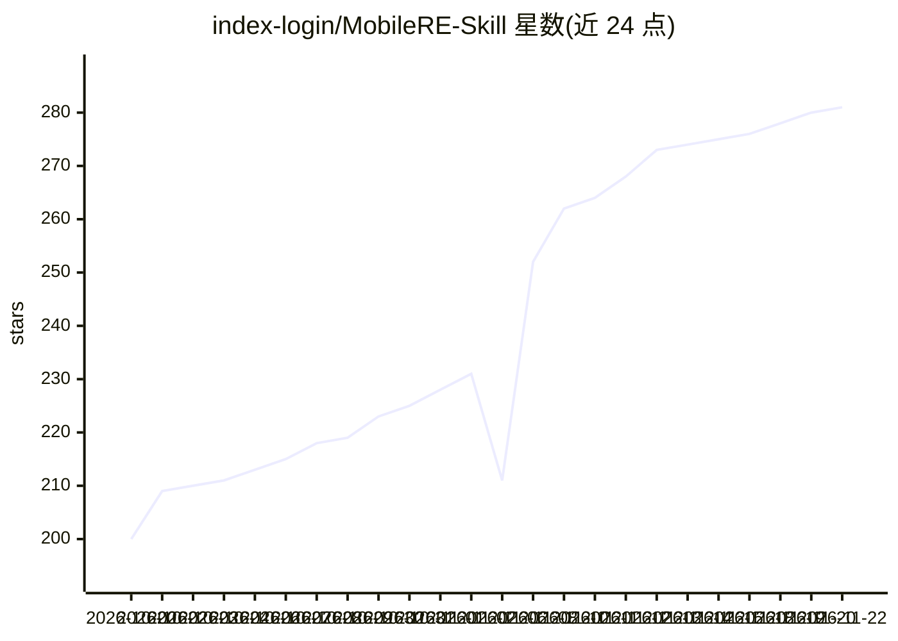

# index-login/MobileRE-Skill

⭐ 281 · JavaScript · MIT · 推送 2026-11-08 · [GitHub](https://github.com/index-login/MobileRE-Skill) · 个人维护 · 中文 README

**面向 AI Agent 的移动端逆向分析技能集**

为 Kilo 等 AI Agent 提供的移动端逆向技能系统，由 Agent 角色定义、9 大技巧域手册、31 个 Frida 模块与 26 个独立工具组成，覆盖脱壳、加密分析、反检测绕过、行为监控、Native 逆向与合规检测等场景。用户以一句话描述需求，Agent 按 SKILL.md 决策树选择模块执行；通过 kilo.json 集成 jadx-mcp 与 ghidra-mcp。运行依赖宿主机 Python/Frida/ADB/JADX/Ghidra 等，测试机需 root 并部署 frida-server。

## 筛选速览

| 维度 | 判定 | 备注 |
|---|---|---|
| AI 角色 | `ai-knowledge` | 知识聚合/清单类 |
| 许可风险 | `permissive` | MIT |
| 部署形态 | `library` | 以包/库形式分发 |
| 模型依赖 | — | README 未给出锁定关系 |
| 硬件要求 | — | 无带数字的原话,不猜 |
| 安装摩擦 | `low` | 无编译、无系统依赖或容器化 |
| 成熟度 | — | 结构信号不足 |

## 能力要点

- 一键脱壳 6 步流水线与内存 DEX 双 dumper（ptrace-free）
- 6 阶段反检测 Pipeline（定位检测 SO→抢 init_array→NOP 闪退函数）
- Java→JNI→Native→libc→syscall 分层下钻 hook
- jadx-mcp / ghidra-mcp 集成，AI 直接读源码与反汇编

## 适用场景

- 对授权 App 做加固脱壳并还原 DEX
- 分析 App 的加密算法、密钥与 native 逻辑
- 绕过 Frida 检测后进行动态行为监控
- 对去符号 SO 做函数名与结构体恢复

## 场景标签

`网络安全` · 领域:学习与行业

## 证据(README 行号)

> L1: # MobileRE-Skill — 综合移动端逆向分析 Agent 技能集
> L41: - 📚 **领域知识**（`references/` 项目级 wiki + `.kilo/skill/`）— 9 大技巧域手册（全量索引 `_index.md`）+ 动态分析总控 + Native 深度能力（符号/结构恢复、离线模
> L50: |使用者|人类工程师|**AI Agent**（Kilo 等）|

## 星数曲线

2026-10-20 200 → 2026-11-22 281（+81）

---
*卡片 v1 · prompt 1.4 · 生成 2026-11-18 · 置信度 mid · 依据 README sha `36f951e72674` · [字段定义](../../DATASET.md)*
