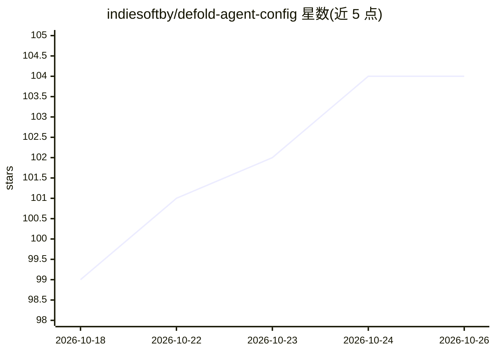

# indiesoftby/defold-agent-config

⭐ 104 · Python · NOASSERTION · 推送 2026-04-23 · [GitHub](https://github.com/indiesoftby/defold-agent-config) · 个人维护 · 中文 README

**Defold 引擎 AI 辅助游戏开发的 AGENTS.md 配置与技能集**

提供 AGENTS.md 配置文件与 .agents/ 目录下 13 个技能（API 文档获取、项目构建、原型文件编辑、着色器/Lua 脚本编辑、Monarch 屏幕搭建等），供 Claude Code、Cursor、Codex CLI 等十余种 AI agent 在 Defold 游戏项目中使用。defold-project-setup 技能将依赖源码下载到 .deps/ 供 agent 只读访问。需 Defold >= 1.12.2 与 Python >= 3.11；安装方式为复制文件到项目根目录，部分 agent 需重命名目录并查找替换。作者自述为研究项目，建议在已有项目上使用。CC0 公共领域许可。

## 筛选速览

| 维度 | 判定 | 备注 |
|---|---|---|
| AI 角色 | `ai-ecosystem` | LLM/agent 周边工具 |
| 许可风险 | `none` | NOASSERTION |
| 部署形态 | `None` |  |
| 模型依赖 | — | README 未给出锁定关系 |
| 硬件要求 | — | 无带数字的原话,不猜 |
| 安装摩擦 | `low` | 无编译、无系统依赖或容器化 |
| 成熟度 | `idea` | |

## 能力要点

- 13 个 Defold 专用技能（API 抓取、构建、原型编辑、着色器编辑等）
- 兼容 Claude Code、Cursor、Codex CLI 等 15+ 种 AI agent
- .deps/ 机制让 agent 只读访问依赖 API 与类型
- 针对 .gitignore 与 agent 索引冲突给出各 agent 配置方案

## 适用场景

- 在 Defold 游戏项目中让 AI agent 按项目约定写脚本和界面
- 让 agent 查阅 Defold API 文档并构建运行项目
- 为多个 AI 编码工具统一提供 Defold 领域知识

## 场景标签

`提示工程` · 领域:Agent 开发

## 证据(README 行号)

> L3: An example configuration of `AGENTS.md` and a set of skills (`.agents/`) for AI-assisted game development with the D
> L11: The configuration uses the `.agents/` directory format, which is supported by:
> L121: |**defold-api-fetch**|Fetches Defold engine API documentation|

## 星数曲线

2026-10-18 99 → 2026-10-26 104（+5）

---
*卡片 v1 · prompt 1.4 · 生成 2026-10-23 · 置信度 high · 依据 README sha `4627f56d382b` · [字段定义](../../DATASET.md)*
