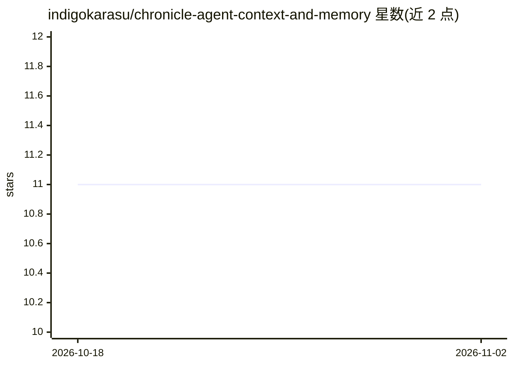

# indigokarasu/chronicle-agent-context-and-memory

⭐ 11 · Python · MIT · 推送 2026-10-24 · [GitHub](https://github.com/indigokarasu/chronicle-agent-context-and-memory) · 个人维护

**为 Hermes Agent 提供本地 SQLite 长期记忆与上下文压缩的插件**

Chronicle 是 Hermes Agent 的双槽位插件：作为 Memory Provider 持久捕获会话历史并跨会话检索相关事实，作为可选 Context Engine 在折叠消息前先将 span 归档，实现可逐字节还原的记忆感知压缩。记忆以事件溯源方式存储于本机 SQLite（~/.hermes/commons/db/chronicle/），含来源、历史、修正、遗忘与访问控制工具，约四十个工具暴露给 agent。无必需 Python 依赖与外部服务，全文检索不依赖 embedding 模型；可选本地 OpenAI 兼容 embedding 服务提升语义召回。要求 Python 3.9+，通过 hermes plugins 命令安装，MIT 许可。

## 筛选速览

| 维度 | 判定 | 备注 |
|---|---|---|
| AI 角色 | `ai-ecosystem` | LLM/agent 周边工具 |
| 许可风险 | `permissive` | MIT |
| 部署形态 | `None` |  |
| 模型依赖 | — | README 未给出锁定关系 |
| 硬件要求 | — | 无带数字的原话,不猜 |
| 安装摩擦 | `low` | 无编译、无系统依赖或容器化 |
| 成熟度 | — | 结构信号不足 |

## 能力要点

- 事件溯源记忆：来源、历史、修正、遗忘与访问控制工具
- 上下文引擎在压缩折叠前归档 span，可逐字节还原
- 无必需服务/API key/嵌入模型，全文检索可用
- 本地 SQLite 存储，约四十个 agent 工具

## 适用场景

- 让 agent 跨会话记住我的偏好、决定与项目进展
- 长对话压缩后仍可找回被折叠的上下文
- 在无外部服务的本机环境运行带持久记忆的 agent

## 场景标签

`Agent 记忆` · 领域:Agent 开发

## 证据(README 行号)

> L5: ### Local-first memory for Hermes Agent that survives restarts, long chats, and context compression.
> L70: |**Memory provider** (`ChronicleMemoryProvider`)|Durably captures conversation history and retrieves relevant facts
> L65: Two Hermes plugin slots share one in-process core. Either slot can run without the

## 星数曲线

2026-10-18 11 → 2026-11-02 11（+0）

---
*卡片 v1 · prompt 1.4 · 生成 2026-11-02 · 置信度 high · 依据 README sha `f73d9264371d` · [字段定义](../../DATASET.md)*
