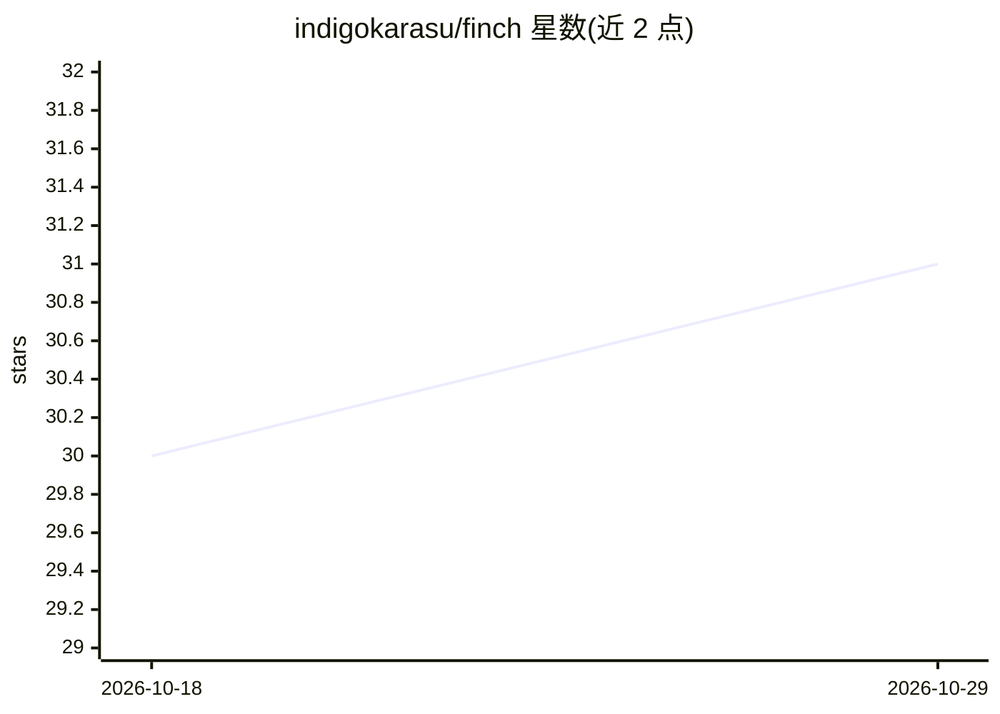

# indigokarasu/finch

⭐ 31 · Python · MIT · 推送 2026-10-24 · [GitHub](https://github.com/indigokarasu/finch) · [官网](https://github.com/indigokarasu/ocas-finch) · 个人维护

**为 Hermes Agent 挖掘会话历史、自动改进技能与记忆的编排器**

OCAS Agent Suite 的组成部分，运行于 Hermes Agent runtime 之上：扫描会话 JSONL 记录，提取纠错、突破与行为模式等学习信号，将其转化为 MEMORY.md 更新与技能补丁；同时压缩 MEMORY.md（去重、重排、逐出、压缩）以维持字符上限。产出 OCAS Action Journals 与 DecisionRecords，低风险发现按日自动应用，其余排队供每周人工审阅。通过 hermes skills install 安装，提供 scan/work/compact/mine/dry-run 五个命令。

## 筛选速览

| 维度 | 判定 | 备注 |
|---|---|---|
| AI 角色 | `ai-ecosystem` | LLM/agent 周边工具 |
| 许可风险 | `permissive` | MIT |
| 部署形态 | `None` |  |
| 模型依赖 | — | README 未给出锁定关系 |
| 硬件要求 | — | 无带数字的原话,不猜 |
| 安装摩擦 | `low` | 无编译、无系统依赖或容器化 |
| 成熟度 | — | 结构信号不足 |

## 能力要点

- 从会话 JSONL 挖掘纠错、突破与行为模式信号
- MEMORY.md 压缩：去重、重排、逐出、压缩以维持字符上限
- 发现按目标路由：规则入 MEMORY.md、方法生成技能补丁
- 低风险发现每日自动应用，其余排队供每周审阅

## 适用场景

- 让 agent 从历史会话的纠错中自动沉淀规则与方法
- 长期运行中防止 MEMORY.md 超出字符上限
- 审阅系统自动产生的行为改进（dry-run 预览后再应用）

## 场景标签

`Agent 记忆` · 领域:Agent 开发

## 证据(README 行号)

> L20: - Mines session JSONL for learning signals (corrections, breakthroughs, patterns)
> L38: Hermes Agent runtime. Reads session transcripts and MEMORY.md from the active profile.

## 星数曲线

2026-10-18 30 → 2026-10-29 31（+1）

---
*卡片 v1 · prompt 1.4 · 生成 2026-10-26 · 置信度 high · 依据 README sha `c4418d53599e` · [字段定义](../../DATASET.md)*
