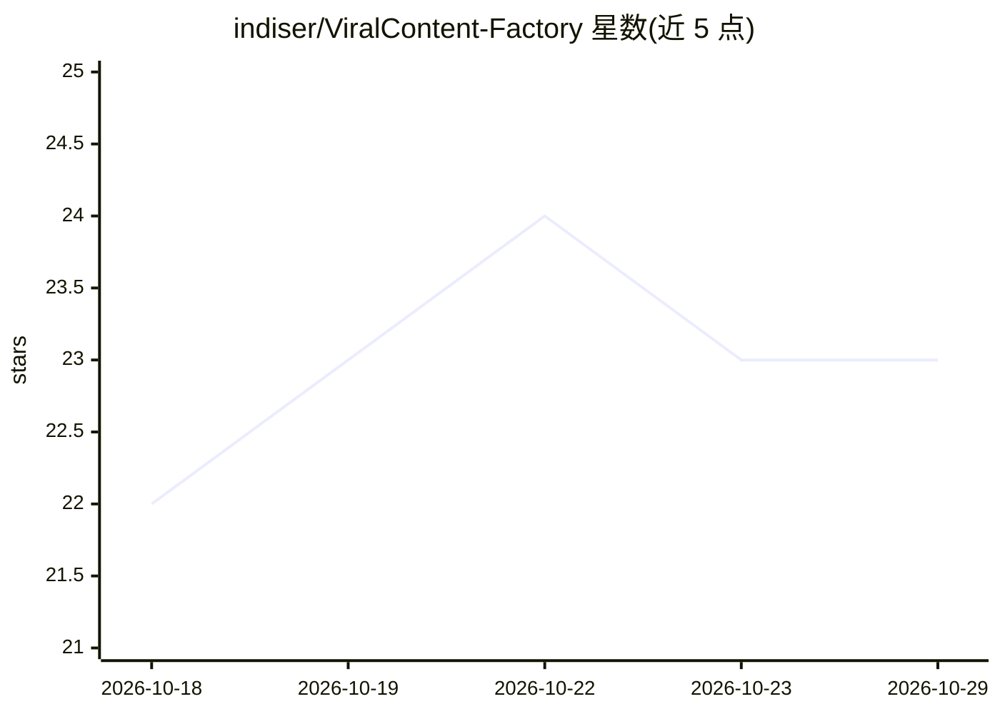

# indiser/ViralContent-Factory

⭐ 23 · Python · MIT · 推送 2026-10-22 · [GitHub](https://github.com/indiser/ViralContent-Factory) · [官网](https://indiser.github.io/ViralContent-Factory/) · 个人维护

**自动化流水线：抓取 Reddit 故事生成 TikTok/Shorts 竖屏视频**

端到端短视频自动生成系统，面向内容创作者：通过 RSS 加浏览器 Cookie 伪装从 30+ subreddit 抓取故事，多供应商 LLM 路由（Groq/Cerebras/Gemini/HuggingFace/OpenRouter，自动配额切换与故障转移）完成性别检测、爆款标题与 SEO 标签生成，Edge-TTS 合成神经配音并导出逐词时间戳，MoviePy 合成 9:16 视频（游戏背景+弹跳字幕）。含 JSON 持久库、按平台已发布标记、批量脚本与 Gmail 邮件提醒；依赖 Reddit 手动导出 Cookie，需至少一个 LLM API key，系统级依赖 FFmpeg/ImageMagick/Deno。

## 筛选速览

| 维度 | 判定 | 备注 |
|---|---|---|
| AI 角色 | `ai-native` | 本体是模型或模型工具 |
| 许可风险 | `permissive` | MIT |
| 部署形态 | `desktop` | 安装包/桌面程序 |
| 模型依赖 | locked-api |  |
| 硬件要求 | — | 无带数字的原话,不猜 |
| 安装摩擦 | `medium` | 含编译或系统依赖之一 |
| 成熟度 | — | 结构信号不足 |

## 能力要点

- RSS 抓取 + curl_cffi Chrome 伪装 + Cookie 会话绕过 Reddit 403
- 多供应商 LLM 路由：快模型做分类、强模型做创意，429 自动切换
- Edge-TTS 神经配音 + 逐词时间戳字幕同步（9:16 竖屏）
- 持久 JSON 数据库按平台跟踪已发布状态，批量 7+ 条触发邮件提醒

## 适用场景

- 定时自动批量产出 Reddit 故事改编的短视频
- 多账号运营者按平台跟踪发布状态并批量上传
- 不想露脸、希望全自动生成配音字幕视频的创作者

## 场景标签

`语音合成` `视频生成` `网页抓取` · 领域:效率与自动化

## 证据(README 行号)

> L10: **Fully automated Reddit story scraping → AI voice synthesis → viral short-form video generation**
> L25: **ViralContent Factory** is an end-to-end automated content generation system that transforms Reddit stories into p
> L60: - **Edge TTS Integration**: Microsoft's neural voices for natural-sounding narration

## 星数曲线

2026-10-18 22 → 2026-10-29 23（+1）

---
*卡片 v1 · prompt 1.4 · 生成 2026-10-27 · 置信度 high · 依据 README sha `106e15a25ecb` · [字段定义](../../DATASET.md)*
