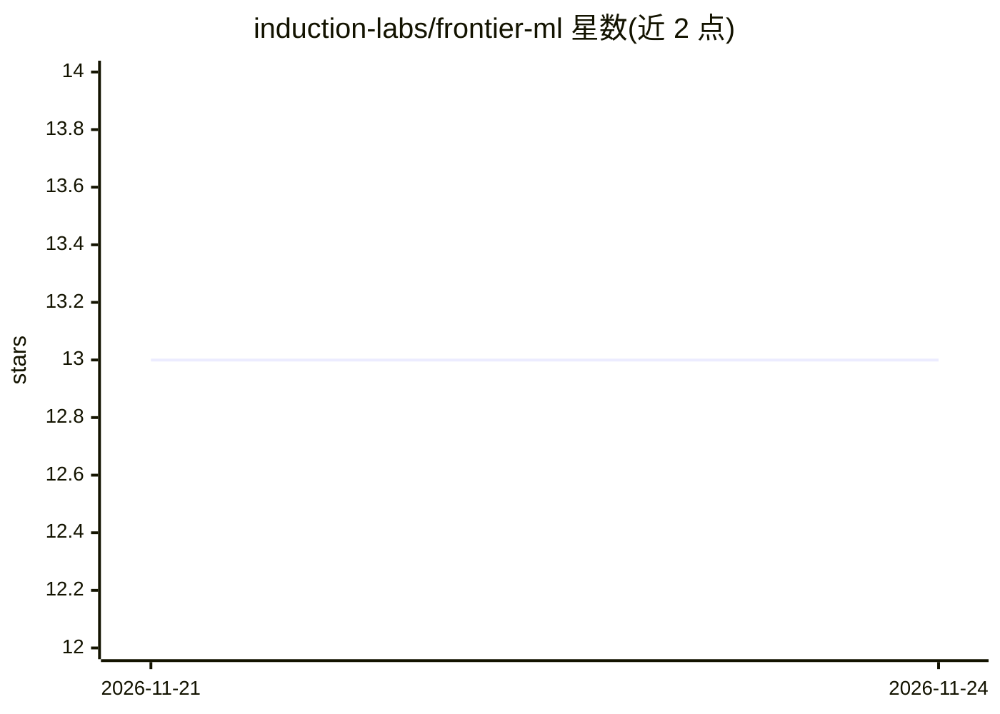

# induction-labs/frontier-ml

⭐ 13 · Python · Apache-2.0 · 推送 2026-11-19 · [GitHub](https://github.com/induction-labs/frontier-ml) · [官网](https://www.frontierml.org/) · 组织维护

**评测 coding agent 用有限算力预算训练 ML 模型能力的基准**

FrontierML 由 Induction Labs 发布，包含 21 个端到端机器学习任务（语言、视觉、音频、游戏）、评测基础设施和 Spin 计算购买服务。评测时每个 agent 获得 12 小时 CPU 沙箱和固定美元预算，用于购买 GPU 和模型 API；agent 自主选择架构、获取数据、运行实验，最后提交独立推理服务器，在无网络的 held-out 数据上打分，并有独立的 review agent 检查提交轨迹是否违规。评测通过 Harbor 运行、Modal 提供沙箱环境，需 uv 与 Modal 账户。

## 筛选速览

| 维度 | 判定 | 备注 |
|---|---|---|
| AI 角色 | `ai-ecosystem` | LLM/agent 周边工具 |
| 许可风险 | `permissive` | Apache-2.0 |
| 部署形态 | `None` |  |
| 模型依赖 | locked-api |  |
| 硬件要求 | — | 无带数字的原话,不猜 |
| 安装摩擦 | `low` | 无编译、无系统依赖或容器化 |
| 成熟度 | — | 结构信号不足 |

## 能力要点

- 21 个端到端任务，覆盖语言、视觉、音频与游戏
- 以美元预算约束 agent 可购买的 GPU 与模型 API 用量（$10/$50/$200 三档）
- 提交的推理服务器在无网络 Modal H100 上评测，独立 review agent 审查合规性
- Spin 服务支持托管使用或基于 Modal/Vast.ai 自托管

## 适用场景

- 评估 coding agent 在给定算力预算下训练模型的表现
- 对比不同 agent 在相同任务与预算设置下的结果
- 自托管 Spin 复现或扩展评测基础设施

## 场景标签

`模型评测` · 领域:评测与运维

## 证据(README 行号)

> L5: FrontierML is a benchmark that measures how well agents turn capital into model performance on challenging, end-to-e
> L9: This repository contains the 21 tasks, the evaluation infrastructure, and Spin, the service agents use to purchase c
> L13: Evaluations run through Harbor, with Modal providing the agent and grading environments. You need uv, a Modal accou

## 星数曲线

2026-11-21 13 → 2026-11-24 13（+0）

---
*卡片 v1 · prompt 1.4 · 生成 2026-11-21 · 置信度 high · 依据 README sha `2a55bff5b3a9` · [字段定义](../../DATASET.md)*
