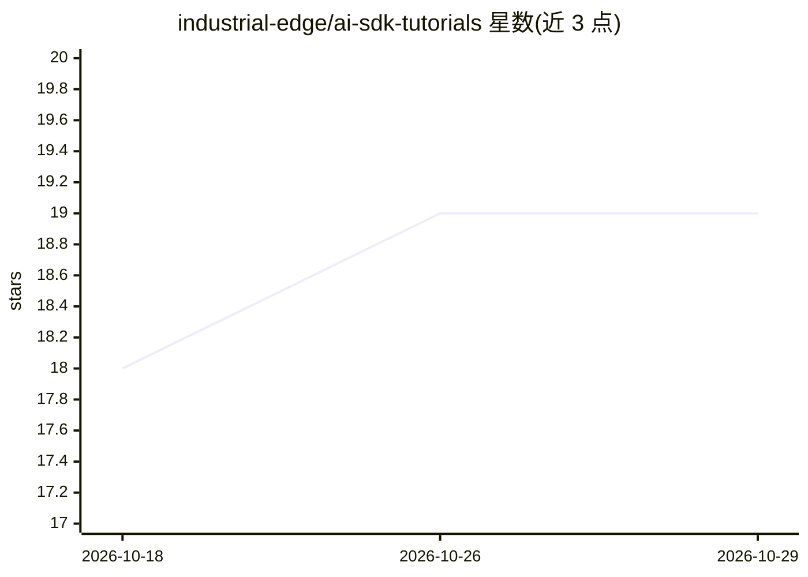

# industrial-edge/ai-sdk-tutorials

⭐ 19 · Jupyter Notebook · NOASSERTION · 推送 2026-08-06 · [GitHub](https://github.com/industrial-edge/ai-sdk-tutorials) · [官网](https://docs.industrial-operations-x.siemens.cloud/access?ft:clusterId=AI_SDK) · 组织维护

**西门子工业 AI SDK 的端到端教程与示例笔记本集合**

Siemens Industrial Edge 维护的 AI SDK（Python 库集 simaticai）教程仓库：通过端到端教程、Howto 指南和可运行的 Jupyter 笔记本，讲解训练数据准备、模型训练、将模型打包为推理管线、本地测试验证、生成面向 AI@Edge 的推理管线等机器学习工作流步骤，用于部署到 AI Inference Server。自 2.6.0 版本起仅在 Linux + Python 3.12 环境下测试，各教程的 README 说明各自的依赖设置。

## 筛选速览

| 维度 | 判定 | 备注 |
|---|---|---|
| AI 角色 | `ai-knowledge` | 知识聚合/清单类 |
| 许可风险 | `none` | NOASSERTION |
| 部署形态 | `library` | 以包/库形式分发 |
| 模型依赖 | — | README 未给出锁定关系 |
| 硬件要求 | — | 无带数字的原话,不猜 |
| 安装摩擦 | `low` | 无编译、无系统依赖或容器化 |
| 成熟度 | — | 结构信号不足 |

## 能力要点

- 覆盖训练到部署的端到端 ML 工作流教程
- AI SDK 2.4.0+ 以 simaticai 名称发布于 PyPI
- 提供 Howto 指南与可运行的 Jupyter 笔记本示例
- 教程可复用于打包和测试用户自有模型

## 适用场景

- 学习如何用 AI SDK 打包自有模型并部署到 AI Inference Server
- 按笔记本示例掌握工业边缘推理管线创建
- 查找模型打包与本地测试的具体操作指引

## 场景标签

`教程课程` · 领域:学习与行业

## 证据(README 行号)

> L5: The AI Software Development Kit, or AI SDK for short, is a set of Python libraries. These libraries provide building
> L15: This collection of guidelines, howto examples, and use case specific solutions contain all the necessary informatio

## 星数曲线

2026-10-18 18 → 2026-10-29 19（+1）

---
*卡片 v1 · prompt 1.4 · 生成 2026-10-28 · 置信度 mid · 依据 README sha `abb7e354810b` · [字段定义](../../DATASET.md)*
