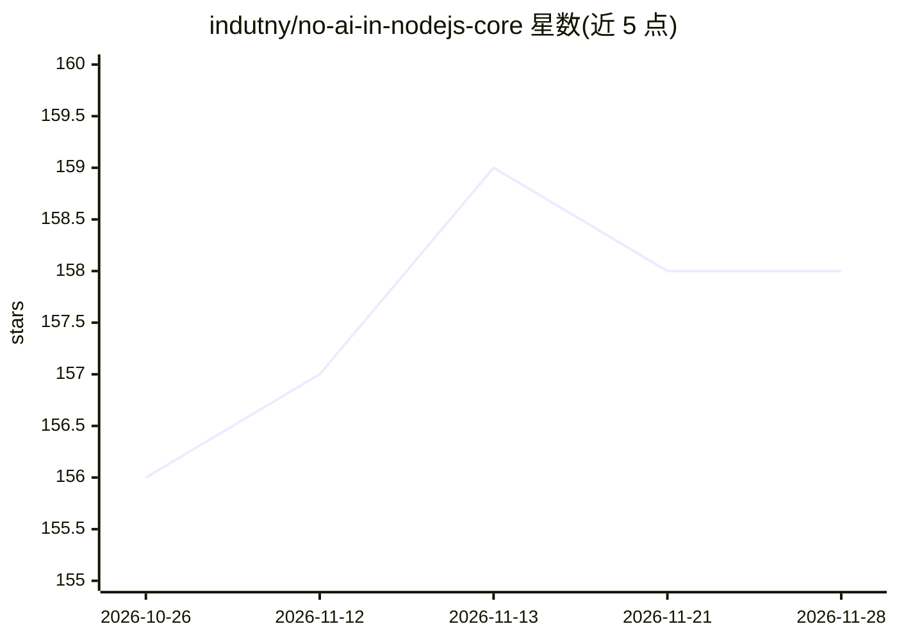

# indutny/no-ai-in-nodejs-core

⭐ 158 · MIT · 推送 2026-11-04 · [GitHub](https://github.com/indutny/no-ai-in-nodejs-core) · 个人维护

**呼吁 Node.js TSC 禁止接受 LLM 生成 PR 的公开请愿书**

一份面向 Node.js 技术指导委员会（TSC）的请愿书，起因是一笔 19k 行、由 Claude Code 生成的核心内部重写 PR（2026 年 1 月）。请愿方要求 TSC 对『是否允许 AI 辅助开发』投票反对，并列出伦理（训练数据来源）、教育（阻碍贡献者学习、审查成本浪费）与特权（LLM 订阅付费墙影响可复现审查）三方面理由。参与方式为提交 PR 署名、开 issue 或在 change.org 匿名签名，README 底部附签名列表。

## 筛选速览

| 维度 | 判定 | 备注 |
|---|---|---|
| AI 角色 | `ai-knowledge` | 知识聚合/清单类 |
| 许可风险 | `permissive` | MIT |
| 部署形态 | `None` |  |
| 模型依赖 | — | README 未给出锁定关系 |
| 硬件要求 | — | 无带数字的原话,不猜 |
| 安装摩擦 | `low` | 无编译、无系统依赖或容器化 |
| 成熟度 | — | 结构信号不足 |

## 能力要点

- 要求 TSC 对 AI 辅助开发提案投反对票
- 列出伦理、教育、特权三类反对理由
- 通过 PR 署名、issue 或 change.org 三种方式征集签名

## 适用场景

- 了解 Node.js 社区对 LLM 生成代码争议的背景与论点
- 以署名方式表达对禁止 AI 代码进入 Node.js 核心的支持
- 研究开源治理中 AI 辅助贡献的政策讨论

## 场景标签

 · 领域:开源社区治理/请愿

## 证据(README 行号)

> L1: # Petition to Node.js TSC: No AI code in Node.js Core
> L3: We, the undersigned, petition the Node.js Technical Steering Committee (TSC)
> L4: to vote **NO** on ["Is AI-assisted development allowed?"][0] and not accept

## 星数曲线

2026-10-26 156 → 2026-11-28 158（+2）

---
*卡片 v1 · prompt 1.4 · 生成 2026-11-27 · 置信度 high · 依据 README sha `50085ea6935c` · [字段定义](../../DATASET.md)*
