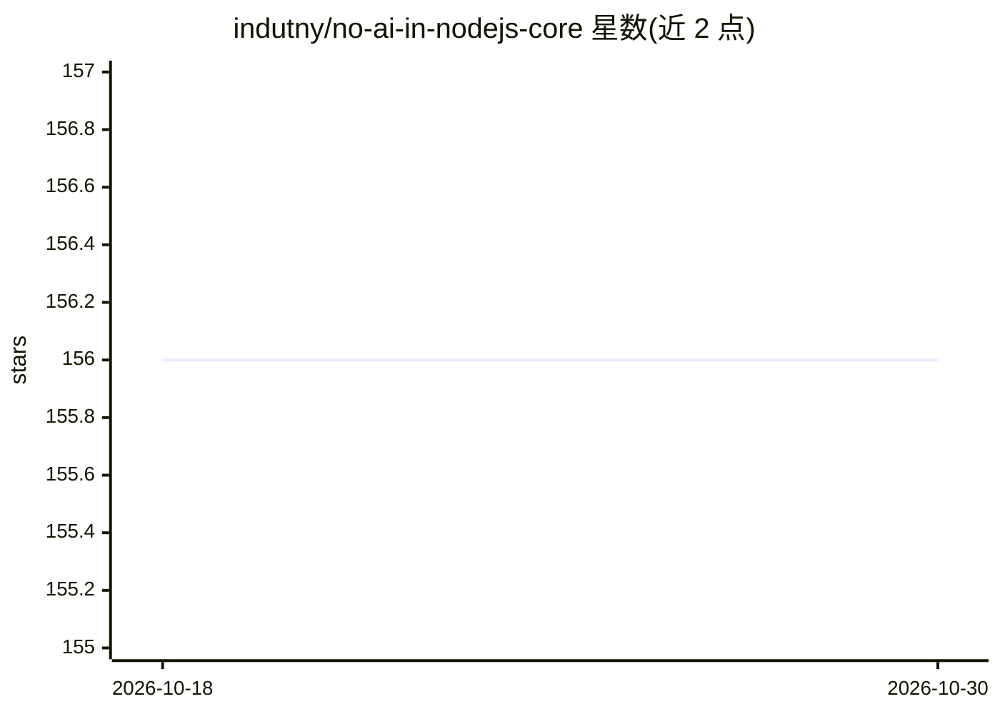

# indutny/no-ai-in-nodejs-core

⭐ 156 · MIT · 推送 2026-09-12 · [GitHub](https://github.com/indutny/no-ai-in-nodejs-core) · 个人维护

**致 Node.js TSC 的请愿书：反对接受 LLM 生成的核心 PR**

由 Fedor Indutny（Node.js TSC 荣誉成员）发起的请愿文档，请求 Node.js 技术指导委员会对『是否允许 AI 辅助开发』投反对票，不接受 LLM 生成的核心内部重写。背景为 2026 年 1 月一个 19k 行、作者声明使用了大量 Claude Code token 的 PR。README 列出伦理（训练数据来源）、教育（阻碍贡献者学习）与特权（LLM 订阅付费门槛）三方面关切。参与者可通过开 PR 在 README 末尾署名、开 issue 或在 change.org 签名。文档末尾附约 120 人签名名单。本仓库为文本请愿，不含可安装运行的软件。

## 筛选速览

| 维度 | 判定 | 备注 |
|---|---|---|
| AI 角色 | `ai-knowledge` | 知识聚合/清单类 |
| 许可风险 | `permissive` | MIT |
| 部署形态 | `None` |  |
| 模型依赖 | — | README 未给出锁定关系 |
| 硬件要求 | — | 无带数字的原话,不猜 |
| 安装摩擦 | `low` | 无编译、无系统依赖或容器化 |
| 成熟度 | — | 结构信号不足 |

## 能力要点

- 请求 TSC 否决 AI 辅助开发提案并拒收 LLM 生成的核心重写
- 从伦理、教育、特权三个角度陈述反对理由
- 提供三种签名途径：PR 署名 / issue / change.org
- 签名者含多位 Node.js 核心协作员与知名开源开发者

## 适用场景

- 以 PR 或 issue 方式为请愿署名
- 了解反对 Node.js 核心接受 LLM 代码的论据
- 跟踪开源社区对 AI 生成代码贡献政策的讨论

## 场景标签

 · 领域:开源治理/AI 政策倡议

## 证据(README 行号)

> L3: We, the undersigned, petition the Node.js Technical Steering Committee (TSC)
> L4: to vote **NO** on ["Is AI-assisted development allowed?"][0] and not accept
> L17: [A 19k lines-of-code Pull Request][1] was opened in January, 2026. The

## 星数曲线

2026-10-18 156 → 2026-10-30 156（+0）

---
*卡片 v1 · prompt 1.4 · 生成 2026-10-22 · 置信度 high · 依据 README sha `620d0bb25679` · [字段定义](../../DATASET.md)*
