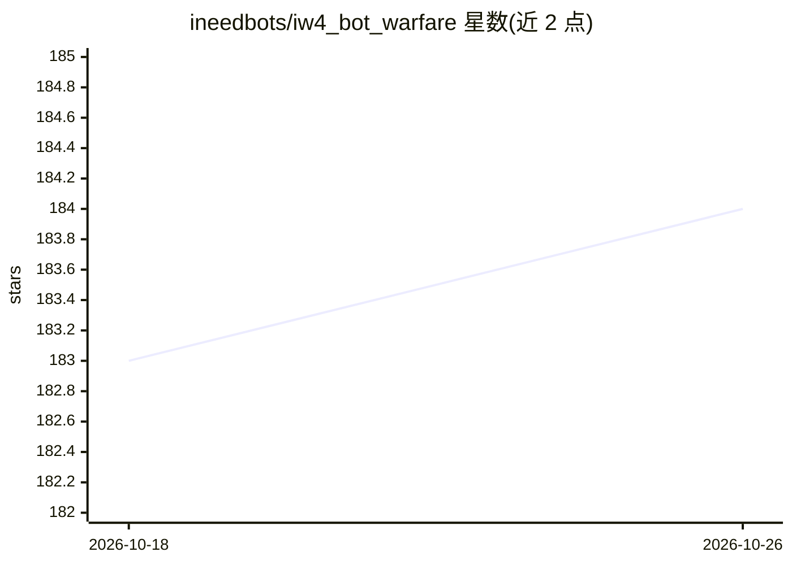

# ineedbots/iw4_bot_warfare

⭐ 184 · GSC · 推送 2026-06-16 · [GitHub](https://github.com/ineedbots/iw4_bot_warfare) · [官网](https://www.moddb.com/mods/bot-warfare) · 个人维护

**MW2（IW4x）多人游戏加 AI 机器人的 GSC 模组**

面向 IW4x 客户端的《使命召唤：现代战争2》GSC 模组，向多人对局中加入 AI 客户端以模拟真实玩家（相当于 MW2 的 Combat Training）。机器人以引擎原生输入移动、瞄准、完成各类模式目标、使用连杀奖励与装备，行为与难度通过 40 余个 DVAR 配置；附带航点编辑器与 CSV 航点加载，不改任何原版 .gsc 文件，与其他模组兼容。安装方式为从发布包复制文件到 MW2 目录，适用于个人与专用服务器。

## 筛选速览

| 维度 | 判定 | 备注 |
|---|---|---|
| AI 角色 | `ai-enhanced` | 去掉 AI 部分产品仍成立 |
| 许可风险 | `none` | — |
| 部署形态 | `None` |  |
| 模型依赖 | — | README 未给出锁定关系 |
| 硬件要求 | — | 无带数字的原话,不猜 |
| 安装摩擦 | `low` | 无编译、无系统依赖或容器化 |
| 成熟度 | — | 结构信号不足 |

## 能力要点

- 机器人覆盖所有游戏模式目标、连杀奖励与装备使用
- 航点编辑器可创建/修改机器人寻路航点并支持 CSV 加载
- 40+ 个 DVAR 配置机器人数量、队伍、难度与行为开关
- 不修改任何原版 .gsc 文件，与其他模组兼容

## 适用场景

- 单人或人少时填充对局获得多人体验
- 专用服务器维持对局人数与队伍平衡
- 自定义地图上编辑航点让机器人可通行

## 场景标签

 · 领域:游戏/模组

## 证据(README 行号)

> L4: Bot Warfare is a GSC mod for IW4x.
> L23: - Adds AI clients to multiplayer games to simulate playing real players. (essentially Combat Training for MW2)

## 星数曲线

2026-10-18 183 → 2026-10-26 184（+1）

---
*卡片 v1 · prompt 1.4 · 生成 2026-10-22 · 置信度 mid · 依据 README sha `a8bf022b61ec` · [字段定义](../../DATASET.md)*
