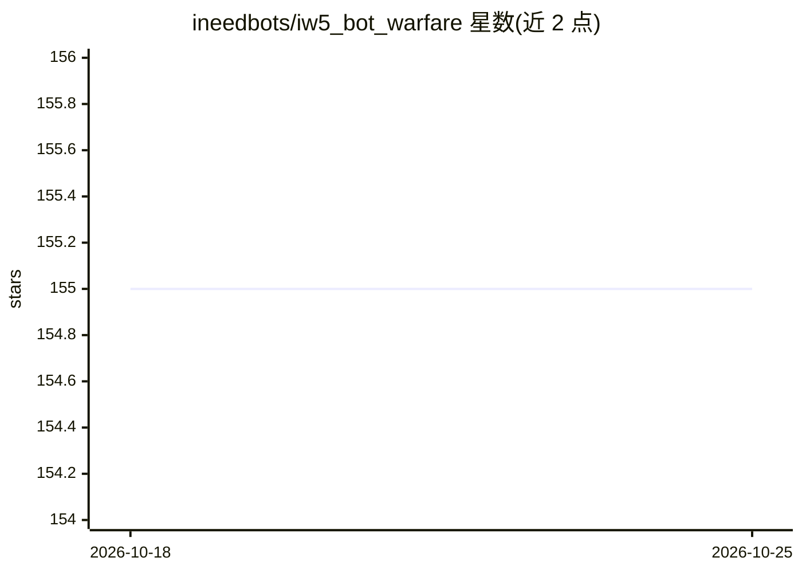

# ineedbots/iw5_bot_warfare

⭐ 155 · GSC · 推送 2026-03-12 · [GitHub](https://github.com/ineedbots/iw5_bot_warfare) · [官网](https://www.moddb.com/mods/bot-warfare) · 个人维护

**给 MW3 多人游戏添加可玩 AI 机器人的 GSC 模组**

面向 PlutoniumIW5 平台的《使命召唤：现代战争3》GSC 模组，在多人对局中添加模拟真实玩家的 AI 客户端：机器人以原生引擎输入移动、按键，游玩全部游戏模式与目标（占旗、拆弹等）、使用连杀奖励与全部武器配装，难度、行为开关、队伍分配等均通过 DVAR 与游戏内菜单配置。附带回径点编辑器，用于创建与修改机器人在地图上的寻路回径点。不修改任何原版 .gsc 文件，与其他模组兼容；通过安装包解压后运行 install.bat 安装，需先装好 PlutoniumIW5。适用于个人游戏与专用服务器。

## 筛选速览

| 维度 | 判定 | 备注 |
|---|---|---|
| AI 角色 | `ai-native` | 本体是模型或模型工具 |
| 许可风险 | `none` | — |
| 部署形态 | `None` |  |
| 模型依赖 | — | README 未给出锁定关系 |
| 硬件要求 | — | 无带数字的原话,不猜 |
| 安装摩擦 | `low` | 无编译、无系统依赖或容器化 |
| 成熟度 | — | 结构信号不足 |

## 能力要点

- 机器人以原生引擎输入完成移动、开火、占点、使用连杀奖励等全部游戏行为
- 内置游戏内菜单，可编辑全部机器人 DVAR 配置
- 提供回径点（Waypoint）编辑器用于自定义寻路
- 不修改原版 .gsc 文件，与其他模组兼容

## 适用场景

- 在 MW3 多人中补充机器人凑满对局人数
- 离线或人少时练习对枪与各游戏模式
- 专用服务器上维持对局人数与队伍平衡

## 场景标签

 · 领域:游戏/游戏服务器模组

## 证据(README 行号)

> L4: Bot Warfare is a GSC mod for the PlutoniumIW5 project.
> L21: - Adds AI clients to multiplayer games to simulate playing real players. (essentially Combat Training for MW3)

## 星数曲线

2026-10-18 155 → 2026-10-25 155（+0）

---
*卡片 v1 · prompt 1.4 · 生成 2026-10-22 · 置信度 mid · 依据 README sha `b405ab57bd1b` · [字段定义](../../DATASET.md)*
