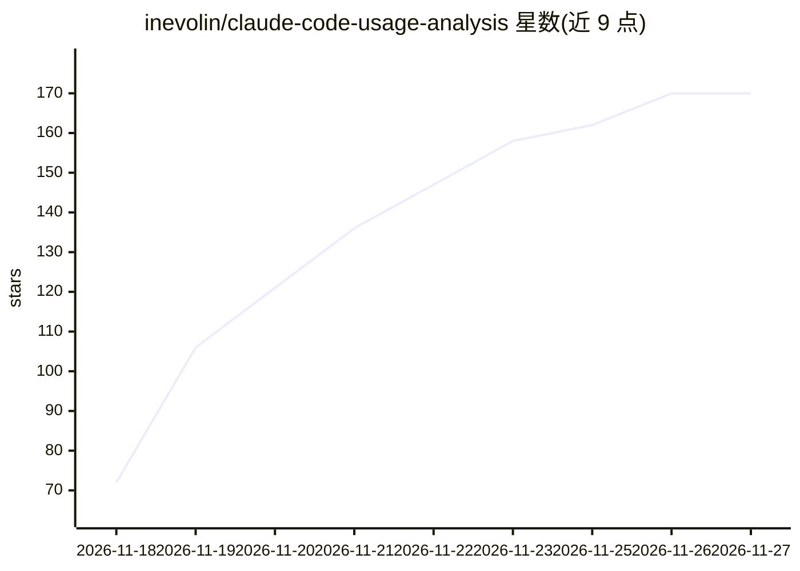

# inevolin/claude-code-usage-analysis

⭐ 170 · Python · MIT · 推送 2026-11-23 · [GitHub](https://github.com/inevolin/claude-code-usage-analysis) · [官网](https://nevolin.be) · 个人维护

**Claude Code 用量反模式实测与本地日志分析工具**

围绕 Claude Code 提示缓存（prompt cache）过期造成的用量放大问题，给出实测数据（13 次 API key 实测，缓存过期后续聊约 9.83x）与最佳实践命令（如 /compact、/clear 加三行笔记），并区分实测、初步与估算三类证据。附带本地分析工具：读取 ~/.claude/projects 的时间戳与 token 元数据，生成习惯报告，不读取或上传聊天文本；亦提供 Claude Code skill 安装方式。MIT 许可。

## 筛选速览

| 维度 | 判定 | 备注 |
|---|---|---|
| AI 角色 | `ai-knowledge` | 知识聚合/清单类 |
| 许可风险 | `permissive` | MIT |
| 部署形态 | `library` | 以包/库形式分发 |
| 模型依赖 | — | README 未给出锁定关系 |
| 硬件要求 | — | 无带数字的原话,不猜 |
| 安装摩擦 | `low` | 无编译、无系统依赖或容器化 |
| 成熟度 | — | 结构信号不足 |

## 能力要点

- 13 次实测给出缓存过期后 9.83x 用量数据，并标注证据等级（实测/初步/估算）
- 本地分析工具仅读取元数据，不读取或上传聊天文本
- 提供手动命令、skill 安装与一次性提示词三种自查方式
- 覆盖 cron/CI、idle compact、1 小时缓存 TTL 等配置建议

## 适用场景

- 查清自己的 Claude Code 会话缓存过期频率
- 在长休息前用 /compact 降低续聊用量
- 按自己的日志获取针对性的缓存配置建议

## 场景标签

`LLM 可观测性` · 领域:评测与运维

## 证据(README 行号)

> L1: # Claude Code usage anti-patterns & best-practices
> L42: See how often your own cache expires. This runs on your computer, on metadata in `~/.claude/projects` (timestamps a
> L116: - **Calculated estimate (not measured live):** 1-hour subscription miss (11.0x), scheduled `claude -p --resume` (a

## 星数曲线

2026-11-18 72 → 2026-11-27 170（+98）

---
*卡片 v1 · prompt 1.4 · 生成 2026-11-26 · 置信度 high · 依据 README sha `dec8d0e5fe76` · [字段定义](../../DATASET.md)*
