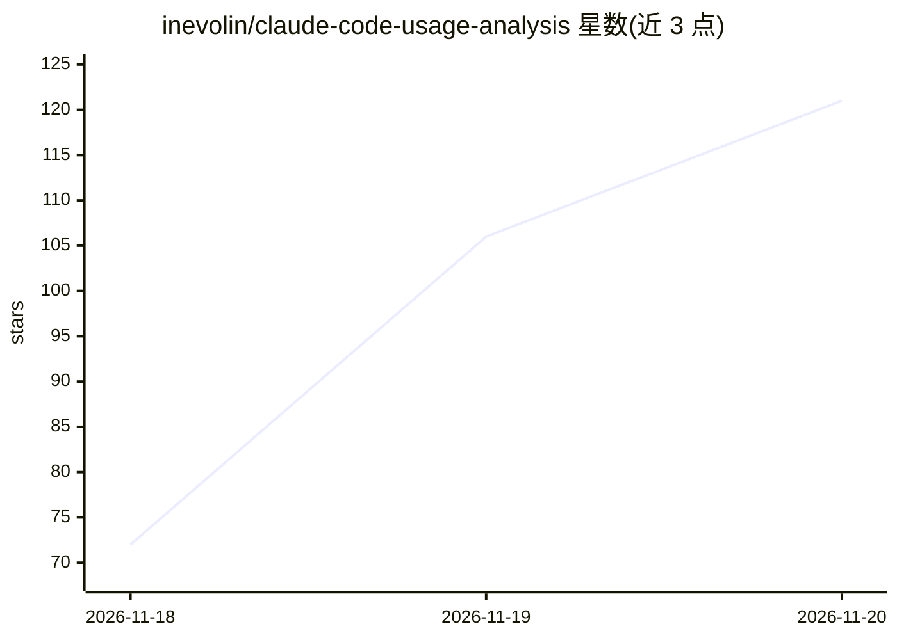

# inevolin/claude-code-usage-analysis

⭐ 121 · Python · MIT · 推送 2026-11-17 · [GitHub](https://github.com/inevolin/claude-code-usage-analysis) · [官网](https://nevolin.be) · 个人维护

**Claude Code token 用量的实证研究：缓存过期与压缩时机分析**

面向使用 Claude Code 的开发者与团队的实证用量研究：通过在专用 API key 上对 Claude Opus 5.5 的多轮实机运行（多数发现 n<3 标注为初步），测量缓存过期、/compact 时机、工具输出长度、CLI 与 Desktop 开销等对 token 用量的影响，并给出最佳实践清单（如休息前 /compact 约 2.5x vs 过期后恢复约 10x）。附带的 Python 分析器读取 ~/.claude/projects 日志生成本地用量报告，不复制提示词文本；也可作为 Claude 技能安装后用 /claude-code-usage-check 调用。

## 筛选速览

| 维度 | 判定 | 备注 |
|---|---|---|
| AI 角色 | `ai-knowledge` | 知识聚合/清单类 |
| 许可风险 | `permissive` | MIT |
| 部署形态 | `library` | 以包/库形式分发 |
| 模型依赖 | — | README 未给出锁定关系 |
| 硬件要求 | — | 无带数字的原话,不猜 |
| 安装摩擦 | `low` | 无编译、无系统依赖或容器化 |
| 成熟度 | — | 结构信号不足 |

## 能力要点

- 缓存过期前后同一小修复用量 1.5x vs 约 10x 的实测数据（含 n 与范围）
- 量化 /compact 时机、长日志、中途关工具（22x）等习惯的开销
- python3 -m cc_usage_study.analyze 本地分析 Claude Code 会话日志，不复制提示词文本
- 提供 Claude 技能安装方式（/claude-code-usage-check）

## 适用场景

- 我想降低 Claude Code 的 token 开销，查找可操作的习惯建议
- 分析自己 ~/.claude/projects 日志核验个人用量模式
- 为团队的 Claude Code 使用规范寻找实测依据

## 场景标签

`LLM 可观测性` · 领域:评测与运维

## 证据(README 行号)

> L95: **Methods in brief.** All live runs used Claude Opus 5.5, effort medium, Claude Code 2.1.325, and the default 5-min
> L43: To run only the analyzer yourself: `python3 -m cc_usage_study.analyze ~/.claude/projects --summary --sessions --cal

## 星数曲线

2026-11-18 72 → 2026-11-20 121（+49）

---
*卡片 v1 · prompt 1.4 · 生成 2026-11-18 · 置信度 mid · 依据 README sha `be8df9f51ade` · [字段定义](../../DATASET.md)*
