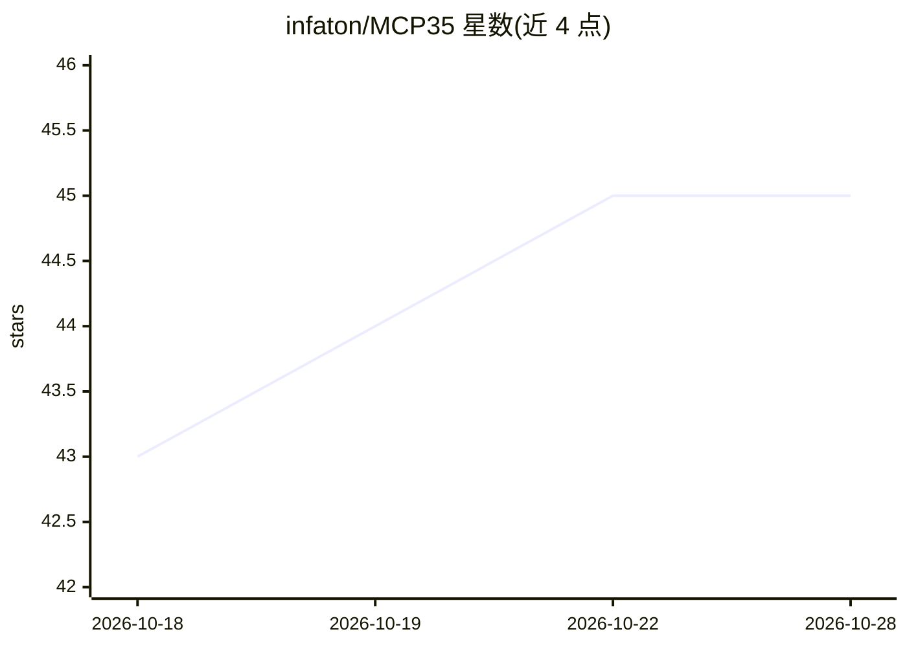

# infaton/MCP35

⭐ 46 · 1C Enterprise · MIT · 推送 2026-10-16 · [GitHub](https://github.com/infaton/MCP35) · [官网](https://infaton.ru) · 组织维护 · 中文 README

**面向 1C:Enterprise ERP 的 MCP 服务器：94 个工具供 AI 访问数据库**

通过 Model Context Protocol（JSON-RPC 2.0）将 AI 助手接入 1C:Предприятие 数据库的 MCP 服务器，提供 94 个工具，覆盖元数据读取、CRUD、任意查询与代码执行、СКД 报表、会计余额与凭证、权限审计、事件日志、数据交换与 CDC 等类别。核心为 BSL 编写的 HTTP 服务模块 Module.bsl（7,574 行），需自行编译为 .cfe 扩展装入 1С 配置；另提供 Node.js stdio 包装（index.mjs）供 Claude Desktop、Cursor 等 MCP 客户端经 npx 或克隆仓库使用，也支持 HTTP Basic Auth 直连。兼容 1C 平台 8.3.20+ 及 ERP 2.5、Бухгалтерия 3.0 等典型配置。属于 INFATON 平台组件，MIT 许可仅覆盖本桥接模块。

## 筛选速览

| 维度 | 判定 | 备注 |
|---|---|---|
| AI 角色 | `ai-ecosystem` | LLM/agent 周边工具 |
| 许可风险 | `permissive` | MIT |
| 部署形态 | `library` | 以包/库形式分发 |
| 模型依赖 | — | README 未给出锁定关系 |
| 硬件要求 | — | 无带数字的原话,不猜 |
| 安装摩擦 | `low` | 无编译、无系统依赖或容器化 |
| 成熟度 | — | 结构信号不足 |

## 能力要点

- 94 个工具：元数据、CRUD、任意查询与代码执行、报表、会计、审计、CDC 等
- BSL HTTP 服务模块 + Node.js stdio 包装双通道接入 MCP 客户端
- ONEC_ALLOWED_TOOLS 工具白名单过滤机制
- 支持通过 curl 以 JSON-RPC 2.0 直接 HTTP 调用

## 适用场景

- 让 Claude Desktop、Cursor 等 AI 客户端直接读写 1C:ERP 数据
- 在 1C 基础上构建数字孪生或 AI agent 业务应用
- 通过任意查询与报表工具对 1C 数据做会计与运营分析

## 场景标签

 · 领域:企业软件/AI 集成

## 证据(README 行号)

> L5: **Model Context Protocol (MCP)** — сервер на стороне 1С:Предприятие, предоставляющий **94 инструмента** для взаимоде
> L28: |`index.mjs`|Node.js stdio-обёртка для MCP-клиентов (Claude Desktop, Cursor и др.)|
> L266: |Транспорт|HTTP (Basic Auth), stdio (через index.mjs)|

## 星数曲线

2026-10-18 43 → 2026-10-28 45（+2）

---
*卡片 v1 · prompt 1.4 · 生成 2026-10-25 · 置信度 high · 依据 README sha `69ffea8b539f` · [字段定义](../../DATASET.md)*
