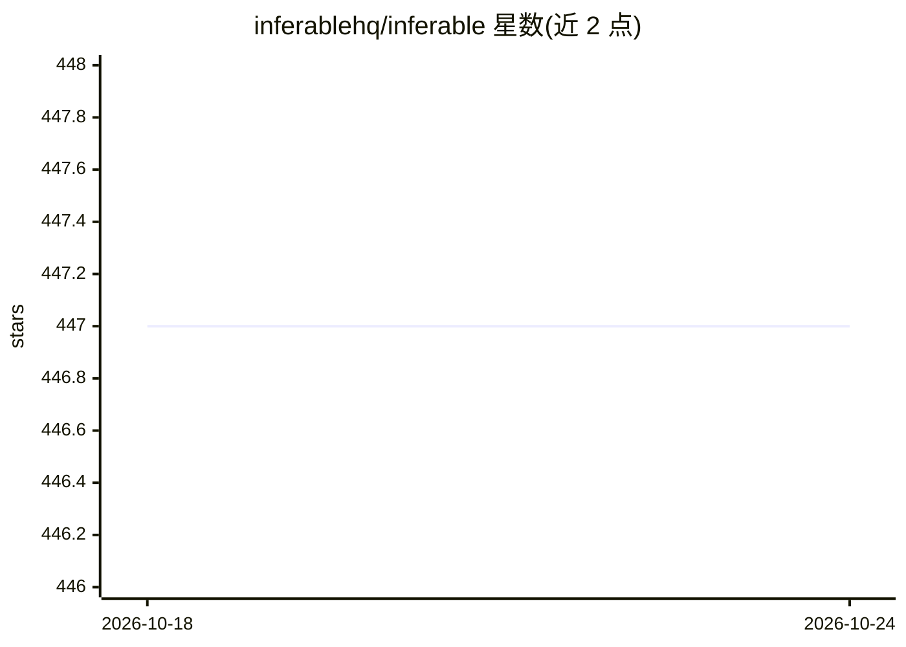

# inferablehq/inferable

⭐ 447 · TypeScript · MIT · 推送 2025-11-24 · [GitHub](https://github.com/inferablehq/inferable) · [官网](https://www.inferable.ai) · 组织维护

**托管持久执行运行时：构建带人工审批的 AI 工作流**

Inferable 是面向开发者的持久执行运行时，用于创建带人工介入环节的 AI 工作流：从任意 LLM 生成结构化输出并自动解析、验证和重试；通过 Slack 或 Email 请求人工审批；工作流在用户自有基础设施上执行（长轮询连接，无需开放入站端口），支持版本化以保持向后兼容。提供 Node.js 与 Go SDK（.NET 实验性），仓库含控制平面、控制台与 CLI，MIT 许可，可自托管。

## 筛选速览

| 维度 | 判定 | 备注 |
|---|---|---|
| AI 角色 | `ai-ecosystem` | LLM/agent 周边工具 |
| 许可风险 | `permissive` | MIT |
| 部署形态 | `None` |  |
| 模型依赖 | — | README 未给出锁定关系 |
| 硬件要求 | — | 无带数字的原话,不猜 |
| 安装摩擦 | `medium` | 含编译或系统依赖之一 |
| 成熟度 | `idea` | |

## 能力要点

- 工作流在用户自有基础设施内执行，长轮询无需开放入站端口
- 任意 LLM 的结构化输出，自动解析、验证与失败重试
- Slack/Email 人工审批与上下文保留的人工介入
- 版本化工作流保持执行中实例的版本亲和

## 适用场景

- 构建需要人工审批节点的长时运行 AI 工作流
- 在私有网络/VPC 内运行工作流并保持数据控制权
- 对接 LLM 生成结构化、经验证的可重试输出

## 场景标签

`工作流自动化` · 领域:效率与自动化

## 证据(README 行号)

> L12: Inferable is a managed durable execution runtime for creating AI workflows with humans in the loop. Create structur
> L87: This repository contains the Inferable control-plane, as well as SDKs for various languages.

## 星数曲线

2026-10-18 447 → 2026-10-24 447（+0）

---
*卡片 v1 · prompt 1.4 · 生成 2026-10-21 · 置信度 high · 依据 README sha `42f980191541` · [字段定义](../../DATASET.md)*
