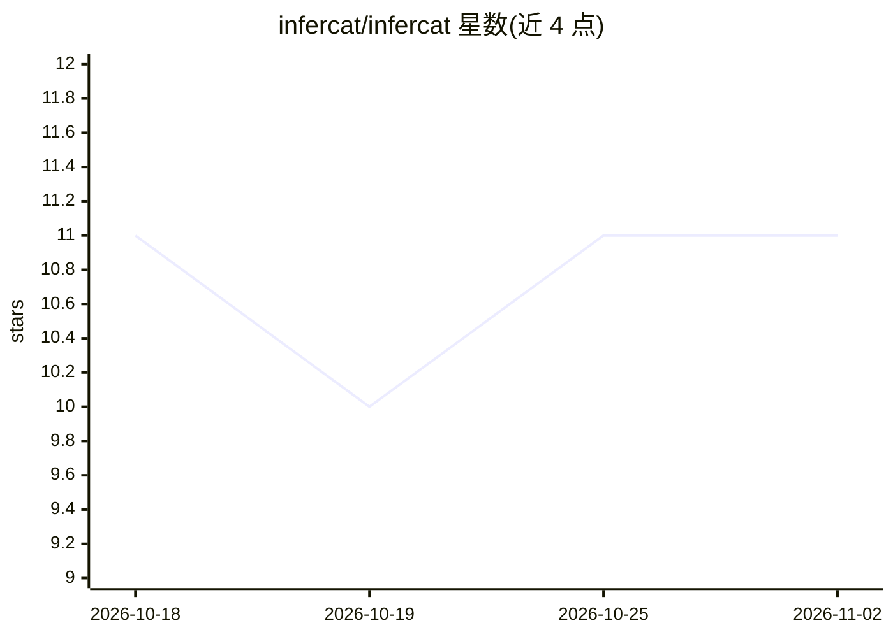

# infercat/infercat

⭐ 11 · Go · MIT · 推送 2026-09-28 · [GitHub](https://github.com/infercat/infercat) · 组织维护 · 中文 README

**把本机推理服务器通过邀请码分享给朋友浏览器对话的网关**

单个二进制运行 `infercat serve`，自动发现已有的推理服务器（llama.cpp、llama-swap、vLLM、Ollama、LM Studio，任何 OpenAI 兼容 /v1/chat/completions 均可），在前端作为网关提供服务。通过基于 tailcat（Tailscale 开源数据平面）的 WireGuard 隧道经 DERP 中继连接，端到端加密，中继只见密文。主人为每个朋友生成一次性邀请码，朋友在网页粘贴即可对话，无需账号与安装；可设按人的限额，支持语音、图像生成、搜索与 agent 运行等托管配方。提供 curl 脚本、Homebrew、Docker、Linux 包等多种安装方式；macOS 二进制未签名，Windows 尚无服务模式。

## 筛选速览

| 维度 | 判定 | 备注 |
|---|---|---|
| AI 角色 | `ai-ecosystem` | LLM/agent 周边工具 |
| 许可风险 | `permissive` | MIT |
| 部署形态 | `None` |  |
| 模型依赖 | local-ok | 支持本地模型 |
| 硬件要求 | `gpu-8g` | |
| 安装摩擦 | `medium` | 含编译或系统依赖之一 |
| 成熟度 | — | 结构信号不足 |

## 能力要点

- 单二进制网关，自动发现 llama.cpp/Ollama/vLLM/LM Studio 等 OpenAI 兼容推理服务器
- 基于 WireGuard 隧道（tailcat/DERP 中继）的端到端加密访问，无账号体系
- 每朋友一把密钥与限额，邀请码一次性显示且仅存哈希
- 附带头像即用的网页客户端，可自托管静态包；支持语音、图像生成、agent 运行配方

## 适用场景

- 把家里 GPU 上跑的本地模型分享给朋友，对方浏览器直接聊
- 为不同朋友发独立邀请码并设置用量限额
- 自托管、无账号地对外提供模型对话服务

## 场景标签

`模型网关` `聊天机器人` · 领域:Agent 开发

## 证据(README 行号)

> L10: Share the model on your machine with friends. You run one binary in front of the inference server you already have 
> L18: - **The host** runs `infercat serve`. It finds the inference server, opens a WireGuard tunnel to a relay, and serve
> L26: You need an inference server running (llama.cpp, llama-swap, vLLM, Ollama or LM Studio; any OpenAI-compatible `/v1/

## 星数曲线

2026-10-18 11 → 2026-11-02 11（+0）

---
*卡片 v1 · prompt 1.4 · 生成 2026-11-02 · 置信度 high · 依据 README sha `3c9065867c76` · [字段定义](../../DATASET.md)*
